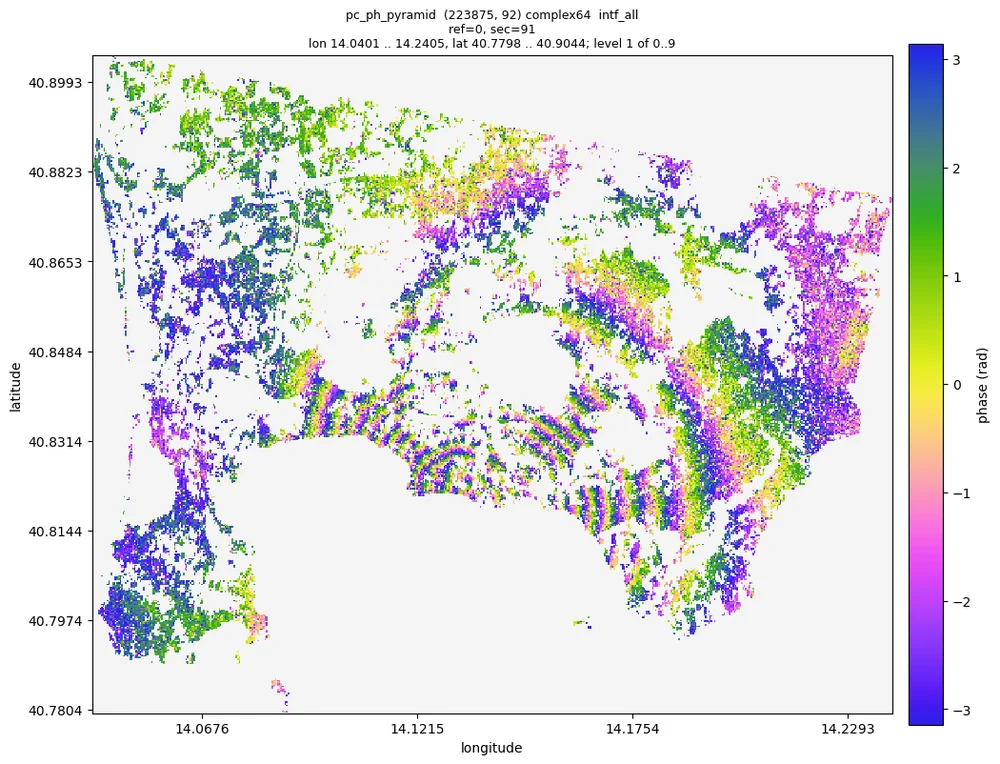
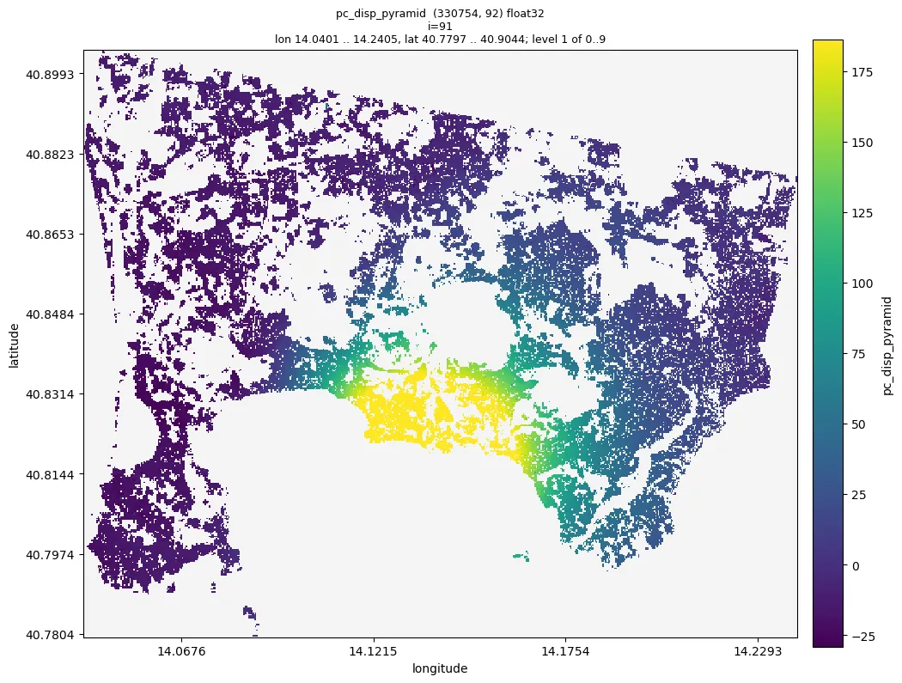

<p align="center">
  <a href="https://kanglcn.github.io/moraine/">
    
  </a>
</p>

<h1 align="center">moraine</h1>

<p align="center">
  <b>Modern Radar Interferometry Environment</b><br>
  InSAR post-processing for the big data era: persistent and distributed scatterers, phase linking, deep learning
  filters and phase unwrapping, on GPUs, on arrays you can read, with a command line that AI agents speak.
</p>

<p align="center">
  <a href="https://github.com/kanglcn/moraine/actions/workflows/test.yaml"></a>
  <a href="https://kanglcn.github.io/moraine/"></a>
  <a href="https://pypi.org/project/moraine/"></a>
  <a href="https://pypi.org/project/moraine/"></a>
  <a href="https://github.com/kanglcn/moraine/blob/main/LICENSE"></a>
</p>

<p align="center">
  <a href="https://kanglcn.github.io/moraine/"><b>Manual</b></a> · <a href="https://kanglcn.github.io/moraine/zh/"><b>中文手册</b></a> ·
  <a href="https://kanglcn.github.io/moraine/start/install/">Install</a> · <a href="https://kanglcn.github.io/moraine/workflows/">Workflows</a> ·
  <a href="https://kanglcn.github.io/moraine/tutorials/">Tutorials</a> · <a href="https://kanglcn.github.io/moraine/api/">Python API</a> ·
  <a href="https://kanglcn.github.io/moraine/dev/changelog/">Changelog</a>
</p>

<table>
  <tr>
    <td width="50%"></td>
    <td width="50%"></td>
  </tr>
  <tr>
    <td align="center"><sub>Interferogram 2019-01-02 / 2021-12-29 of the refined PS and DS:<br>about ten fringes of the caldera uplift, centred on Pozzuoli</sub></td>
    <td align="center"><sub>Line of sight displacement (mm), 2019-01-02 to 2021-12-29:<br>the uplift of Pozzuoli, towards the satellite</sub></td>
  </tr>
</table>

<p align="center"><sub>Campi Flegrei (Italy), Sentinel-1 descending track 22, 92 dates from 2019 to 2021: quicklooks of the
<a href="https://kanglcn.github.io/moraine/workflows/">verified example pipelines</a>.</sub></p>

moraine takes co-registered SAR images (GAMMA results) to deformation time series: it selects persistent and
distributed scatterers, links their phases, filters them with deep learning, unwraps them and computes line of sight
displacements. It is a collection of functions rather than a fixed workflow, made for data larger than memory and for
GPUs, with a command line that people, scripts and AI agents can drive. It is under active development (alpha): the
API can change between versions, as the [changelog](https://kanglcn.github.io/moraine/dev/changelog/) records.

## ✨ Highlights

- 📡 **PS and DS**: amplitude dispersion, statistically homogeneous pixels by a Kolmogorov-Smirnov test, coherence
  matrices, and EMI phase linking with an adaptive regularization of the matrices that are not positive definite.
- 🧠 **Deep learning filters**: Noise2Fringe (`n2f`) for raster interferograms and the Noise2Fringe Transformer
  (`n2ft`) for point clouds, trained models run with PyTorch.
- 🌀 **Phase unwrapping**: minimum cost flow on a Delaunay network of the points, EMCF on any network of image pairs,
  unwrapping errors corrected by phase closure; moraine's own code, no GAMMA needed.
- ⚡ **CPU and GPU**: numba kernels on the CPU cores, numba.cuda kernels on one or several GPUs; most API functions take
  numpy or cupy arrays and return the same kind.
- 📦 **Larger than memory**: zarr on disk, processed chunk by chunk by moraine's own workers; designed for tens of
  millions of points and stacks of hundreds of images.
- 🔁 **Pipelines that resume**: a processing chain is a TOML file; a rerun skips the steps whose arguments and inputs
  did not change and reruns everything downstream of a change.
- 📖 **Self-documenting commands**: every `moraine.cli` function is a `moraine` command whose help (shapes, dtypes,
  units, defaults) is generated from its docstring; `--json` prints one JSON object for scripts and agents.
- 🔍 **Checks without plotting code**: statistics and anomaly warnings of a result (`moraine info`), PNG quicklooks
  (`moraine quicklook`) and notebooks of interactive maps (`moraine view`) with time series, polygons and 3D views
  over the terrain.
- 🤖 **Agent ready**: [AGENTS.md](https://github.com/kanglcn/moraine/blob/main/AGENTS.md) tells coding agents how to
  run and check the processing; you describe the data, the agent runs the verified pipelines and reports.

<details>
<summary><b>🧭 Design principles</b></summary>

Adapted from the principles of [Arch Linux](https://wiki.archlinux.org/title/Arch_Linux).

- **Simplicity**: no complex data structures, no over-encapsulation. Data are numpy or cupy arrays in memory and zarr
  arrays on disk; every result is an array that any tool can open. Instead of a standard workflow like
  [StaMPS](https://homepages.see.leeds.ac.uk/~earahoo/stamps/) or [MintPy](https://mintpy.readthedocs.io/en/latest/),
  moraine is a collection of functions, each implementing one InSAR technique, and the data infrastructure around them.
- **Modernity**: state-of-the-art techniques (PS / DS selection, phase linking, deep learning filters) and the
  performance the big data era needs: numba on the CPU cores, numba.cuda on GPUs, data larger than memory.
- **Pragmatism**: no workflow always gives a satisfactory result; decorrelation, atmosphere and strong deformation
  gradients defeat every fixed chain somewhere. moraine provides the building blocks and the user designs the workflow
  case by case.
- **User centrality**: moraine serves the needs of those who contribute to it rather than trying to appeal to as many
  users as possible. It is made for the proficient InSAR user, or anyone with a do-it-yourself attitude, who is willing
  to read the documentation and solve their own problems.

</details>

## 🛠️ The processing chain

Six example pipelines take GAMMA results to displacements. Each is run end to end on the sample data set and has a
guide with the parameters to tune, the expected results and the checks.

| | pipeline | what it does | main commands |
|---|---|---|---|
| 01 | [Load](https://kanglcn.github.io/moraine/workflows/01_load/) | GAMMA results to zarr: rslc stack, coordinates, look vectors, baselines, metadata | `load-gamma-*`, `transform` |
| 02 | [PS](https://kanglcn.github.io/moraine/workflows/02_ps/) | amplitude dispersion and Noise2Fringe temporal coherence | `amp-disp`, `n2f`, `temp-coh` |
| 03 | [DS](https://kanglcn.github.io/moraine/workflows/03_ds/) | statistically homogeneous pixels, coherence matrices, EMI phase linking, DS selection | `shp-test`, `emperical-co-emi-temp-coh-pc` |
| 04 | [Refine](https://kanglcn.github.io/moraine/workflows/04_refine/) | PS and DS merged, Noise2Fringe Transformer, temporal coherence | `pc-union`, `n2ft`, `temp-coh` |
| 05 | [Unwrap](https://kanglcn.github.io/moraine/workflows/05_unwrap/) | EMCF on a network of image pairs, phase closure correction | `emcf-pc`, `unwrap-correct-closure-pc` |
| 06 | [Products](https://kanglcn.github.io/moraine/workflows/06_products/) | line of sight displacement in millimetres, troposphere from ERA5, reference area, DEM error, velocity, GeoPackage of the points for GIS software | `pc-disp`, `download-era5`, `pc-tropo-era5`, `pc-reference`, `pc-sc-dem-error`, `pc-velocity`, `pc-export` |

## 🚀 Quick start

```bash
pip install moraine                  # or: conda install -c conda-forge moraine
pip install 'moraine[dl]'            # PyTorch, for the deep learning filters
python -c "import moraine; moraine.download_dl_model()"     # the trained models, once
```

Everything runs on the CPU; for GPUs add cupy and numba-cuda for your CUDA version with conda, as the
[install guide](https://kanglcn.github.io/moraine/start/install/) explains. The example pipelines are in the
repository:

```bash
git clone https://github.com/kanglcn/moraine.git && cd moraine
moraine run examples/01_load.toml --workdir WORK \
    --var gamma=/path/to/gamma --var reference=YYYYMMDD --var geo=YYYYMMDD
moraine run examples/02_ps.toml --workdir WORK --var shape=NLINES,WIDTH    # then 03 to 06, in order
moraine status examples/02_ps.toml --workdir WORK      # the state; run a file again to resume it
moraine info WORK/ps/ras_adi_pyramid                   # statistics of a result, without loading it
moraine quicklook WORK/ps/ras_adi_pyramid -o adi.png   # a picture of the whole scene
moraine view WORK/ps/ras_adi_pyramid -o view.ipynb     # interactive maps in Jupyter or VS Code
```

Examples 02 to 04 run on a GPU (`cuda = true`): to run them on the CPU or to change a parameter, copy the file and edit
the copy. The [workflow guides](https://kanglcn.github.io/moraine/workflows/) give the variables of every file, and the
[tutorials](https://kanglcn.github.io/moraine/tutorials/) run the same chain from Python.

<details>
<summary><b>🐍 The same from Python</b></summary>

```python
import moraine as mr          # arrays in memory: numpy on the CPU, cupy on the GPU
import moraine.cli as mc      # zarr in, zarr out, chunk by chunk

ph = mr.emi(coh)                                               # phase linking of a block of points
mc.emi('ds/ds_can_coh.zarr', 'ds/ds_can_ph.zarr', cuda=True)   # the same for a whole data set, on the GPUs
mc.view('pc/pc_ph_pyramid', show='intf_seq')                   # an interactive map in a notebook
```

`help(mr.emi)`, `help(mc.emi)` and `moraine emi --help` describe the same function.

</details>

<details>
<summary><b>🤖 Or ask a coding agent</b></summary>

> process the GAMMA data in `/data/site_a` (reference 20220620) up to unwrapping in `/work/site_a`

A coding agent working in the repository (Claude Code, Codex, Cursor, ...) reads
[AGENTS.md](https://github.com/kanglcn/moraine/blob/main/AGENTS.md) and the workflow guides, runs the verified
pipelines, compares the results with the expected ranges, looks at the quicklooks and reports. The manual has a
[recorded session](https://kanglcn.github.io/moraine/agent/) on the Campi Flegrei data set.

</details>

## 📚 Documentation

**[The manual](https://kanglcn.github.io/moraine/)** is in English and [中文](https://kanglcn.github.io/moraine/zh/).
Its main pages:

| page | what is there |
|---|---|
| [Install](https://kanglcn.github.io/moraine/start/install/) | pip or conda, the GPU packages, the deep learning models, GAMMA |
| [Concepts](https://kanglcn.github.io/moraine/start/concepts/) | the three layers, rasters and point clouds, chunks, pipelines, GPU or CPU |
| [Checking results](https://kanglcn.github.io/moraine/start/checking/) | pyramids, `moraine info`, `moraine quicklook`, `moraine view` |
| [Workflows](https://kanglcn.github.io/moraine/workflows/) | the six example pipelines with their parameters, expected results and checks |
| [Tutorials](https://kanglcn.github.io/moraine/tutorials/) | the same chain as notebooks of `moraine.cli` calls with interactive maps |
| [Command line](https://kanglcn.github.io/moraine/cli/), [Python API](https://kanglcn.github.io/moraine/api/) | every command and function, generated from the docstrings: arguments, shapes, dtypes, defaults, examples |
| [Theory](https://kanglcn.github.io/moraine/theory/emcf/) | the principle of EMCF unwrapping and of the phase closure correction |
| [Talk to an agent](https://kanglcn.github.io/moraine/agent/) | a recorded session of an AI agent processing a data set |
| [Changelog](https://kanglcn.github.io/moraine/dev/changelog/), [Roadmap](https://kanglcn.github.io/moraine/roadmap/) | what changed, what is planned |

In the terminal, `moraine list` lists the commands and `moraine COMMAND --help` prints the reference of one.

## 🤝 Contributing

Bug reports and feature requests are welcome as [issues](https://github.com/kanglcn/moraine/issues), questions and
ideas in the [discussions](https://github.com/kanglcn/moraine/discussions), fixes, documentation and new methods as
pull requests. [Developing moraine](https://kanglcn.github.io/moraine/development/) explains how a change is
discussed, made, validated and submitted, [ARCHITECTURE.md](https://github.com/kanglcn/moraine/blob/main/ARCHITECTURE.md)
maps the code and the [design decisions](https://kanglcn.github.io/moraine/decisions/) say why it is built this way.

## 📜 License

moraine is free software under the GNU General Public License, version 3 or (at your option) any later version
([GPL-3.0-or-later](https://github.com/kanglcn/moraine/blob/main/LICENSE)). The trained deep learning models,
downloaded by `moraine.download_dl_model()`, are under
[CC BY-NC-SA 4.0](https://creativecommons.org/licenses/by-nc-sa/4.0/).

## ⭐ Star history

<a href="https://www.star-history.com/#kanglcn/moraine&Date">
  <picture>
    <source media="(prefers-color-scheme: dark)" srcset="https://api.star-history.com/svg?repos=kanglcn/moraine&type=Date&theme=dark">
    
  </picture>
</a>
