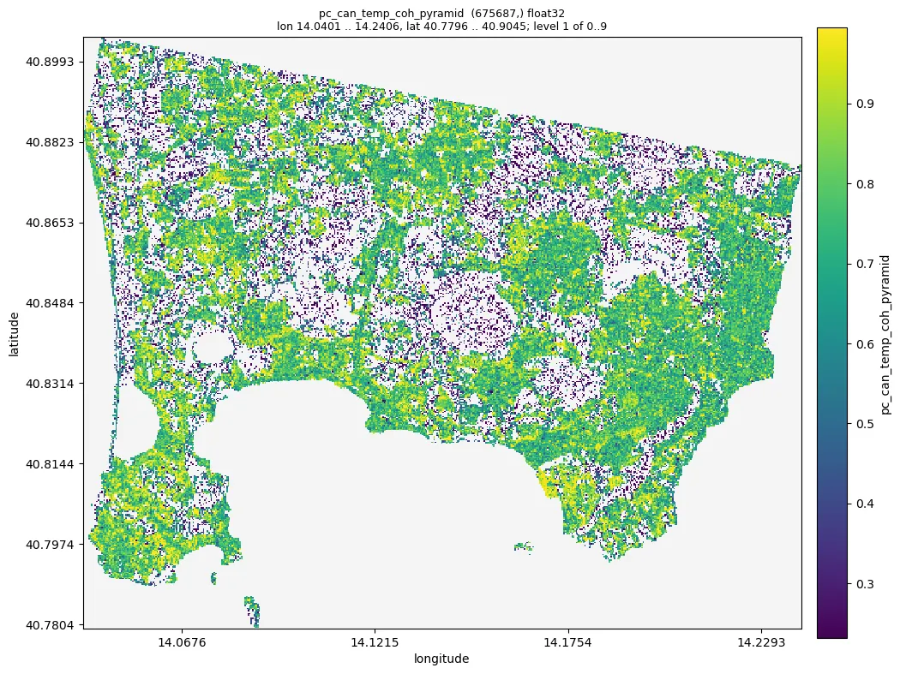
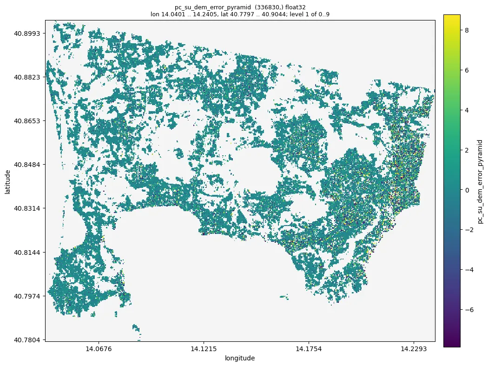
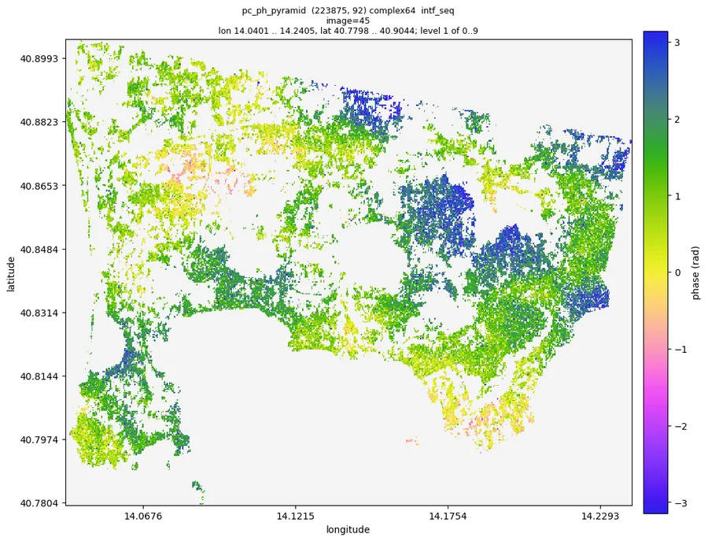
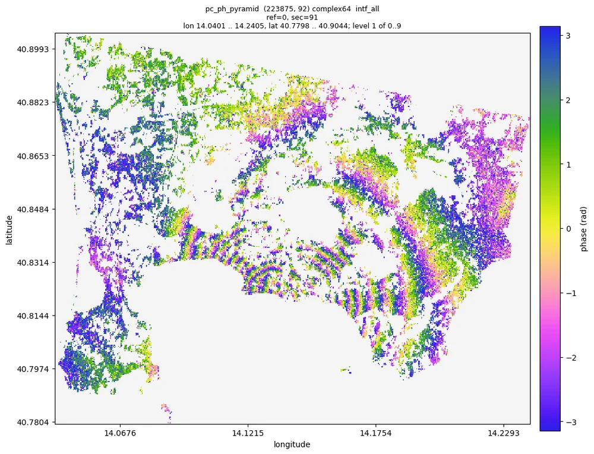

# 04 Merge PS and DS, refine with n2ft

Pipeline: `examples/04_refine.toml`. Tutorial: `nbs/Tutorials/CLI/CampiFlegrei/04_refine.ipynb`.
Needs `02_ps` and `03_ds`.

```bash
moraine run examples/04_refine.toml --workdir WORK
```

## Steps

1. `pc-union` of the DS (their phase history) and the PS candidates (their rslc), with e/n; a point in both
   sets keeps the DS phase history (the first input of `pc-union` wins);
   `ras2pc` adds lon/lat.
2. `image-pairs` (sequential) and `n2ft`: Noise2Fringe Transformer filtering of the point cloud
   interferograms (chunks of 20 000 points with k nearest neighbour halos).
3. `ras2pc`: height, look vector, slant range and perpendicular baselines of the candidates.
4. `pc-su-dem-error`: the DEM error of every candidate relative to its neighbourhood in the filtered
   interferograms (a roof above the ground around it, decision 0048), searched within +-`max_dh`, and the
   temporal coherence between the filtered and the raw phase without it. A point above or below its neighbourhood
   differs from the filtered interferograms in proportion to the perpendicular baselines; without this DEM error
   the temporal coherence takes it for noise (Sentinel-1, 70 m between the baselines of neighbouring dates: a
   roof 20 m above the ground loses a fifth of its coherence).
5. Points with temporal coherence > 0.8 are kept (`pc-logic-pc`, `pc-select-data`), with their phase without the
   DEM error relative to the neighbourhood, which `05_unwrap` unwraps.

Outputs (WORK/pc/): merged candidates `pc_can_*`; refined points `pc_hix.zarr`, `pc_ph.zarr`
(n_points, nimages), their phase without the DEM error relative to the neighbourhood `pc_ph_demcor.zarr`, that
DEM error `pc_su_dem_error.zarr` (n_points,) float32 m (positive above the neighbourhood), their coordinates
`pc_e.zarr`, `pc_n.zarr`, `pc_lon.zarr`, `pc_lat.zarr`, their temporal coherence `pc_temp_coh.zarr`, and the
geometry the deformation products need: height `pc_hgt.zarr`, look vector `pc_theta.zarr`, `pc_phi.zarr` (GAMMA
elevation and orientation angles, radians), slant range `pc_range.zarr` (m) and the perpendicular baseline of
every image `pc_bperp.zarr` (n_points, nimages) float32 m, 0 for the reference image (from `raw/bperp.zarr` of the
01 step); pyramids `pc_can_temp_coh_pyramid`, `pc_ph_pyramid`, `pc_su_dem_error_pyramid`.

## Parameters

- Temporal coherence threshold: 0.7-0.85; lower keeps more points with more noise.
- `max_dh` of `pc-su-dem-error`: the search range of the DEM error relative to the neighbourhood, 20 m by default
  (as StaMPS); the example takes 100 m for the buildings of Naples. A point further from its neighbourhood gets a
  low temporal coherence and is dropped. Fitting the DEM error raises the temporal coherence of noise a little
  (random phases: 0.35 at p99.99 with the 91 image pairs of the sample data and +-80 m), far below the threshold;
  with few image pairs check it on random phases.
- `n2ft` `chunks`: points per chunk (20 000); smaller uses less GPU memory.
- `n2ft` `compile`: the model is compiled with torch.compile in every worker when points times image pairs is at
  least 1e8 (15-40 s once per worker, less when torch has cached it; the model then runs about 3 times faster on a
  GPU); `compile = true` or `false` forces it. Not worth it for the sample data.

## Expected results (sample data, Campi Flegrei, 981 x 4160 x 92)

| result | sample value | sane range |
|---|---|---|
| merged candidates | 675 687 | about PS + DS minus overlap |
| log of `su_dem_error` | DEM error of 675 687 candidates: percentiles 5, 50, 95 -7.07, -0.04, 7.37 m; temporal coherence median 0.799, > 0.8 for 336 830 points | about 0 in the middle |
| `pc_can_temp_coh_pyramid` | p50 0.80, p01 0.23, p99 0.995 | 0..1 |
| refined points (`pc_hix`) | 336 830 (49.9 % of the candidates; 99.9 % of the DS, 33.4 % of the PS candidates that are not DS); 330 754 with the temporal coherence of `temp-coh`, without the DEM error relative to the neighbourhood (+1.8 %, none lost) | |
| `pc_su_dem_error_pyramid` | p01 -7.9, p50 0.0, p99 8.8, min -48, max 42 (m); 1.1 % of the points beyond 10 m | about 0, buildings up to tens of meters; many points at +-`max_dh`: higher structures |
| `pc_bperp` | -73 to 142 m, no nan, 0 for the reference 20200707; over the points of an image it changes by 0.6 m (median) to 1.6 m | as `raw/bperp.zarr` |

The points gained by the DEM error relative to the neighbourhood are PS candidates, 11 % of them more than 15 m
above or below their neighbourhood (p05 -14.3, p50 2.6, p95 16.4 m).

Run time: about 50 s with an A100 (n2ft 30 s for 91 image pairs, `pc-su-dem-error` 4.2 s for 675 687 candidates).
Large data (10 million candidates, 92 images, 91 image pairs, `max_dh = 20`): `pc-su-dem-error` 51 s and 1.3 GB peak
memory, with the phase output.

## Figures

Quicklooks of the sample data run of 2026-11-15 (the numbers above are from the same run) and, for the
interferograms, of 2026-10-10 (1.8 % fewer refined points, the same phase):



*Temporal coherence of the merged candidates after the Noise2Fringe Transformer, without their DEM error relative to
the neighbourhood (`pc/pc_can_temp_coh_pyramid`).*



*DEM error of the refined points relative to their neighbourhood in the filtered interferograms
(`pc/pc_su_dem_error_pyramid`): about 0 on average everywhere; single buildings and blocks stand out from the ground
around them.*



*Sequential interferogram 45 (2020-07-07 / 2020-07-19) of the refined points (`pc/pc_ph_pyramid --show intf_seq
--index 45`): continuous phase, no noise.*



*Interferogram 2019-01-02 / 2021-12-29 of the refined points (`--show intf_all --index 0 91`): the concentric fringes
of the caldera uplift centred on Pozzuoli, about ten fringes over three years.*

## Checks

- `moraine quicklook pc/pc_ph_pyramid --show intf_seq --index I -o pc_intf.png`: interferograms of
  the refined points should show smooth, spatially continuous phase (fringes), not noise.
- Compare with the raw interferogram: `moraine quicklook raw/rslc_pyramid --show intf_seq --index I`.

## Problems

- `n2ft` is slow on CPU; use a GPU.
- Many points with `pc_su_dem_error` at +-`max_dh`: structures higher than the search range; raise `max_dh`.
- Too few points: lower the temporal coherence threshold or revisit PS / DS thresholds.
