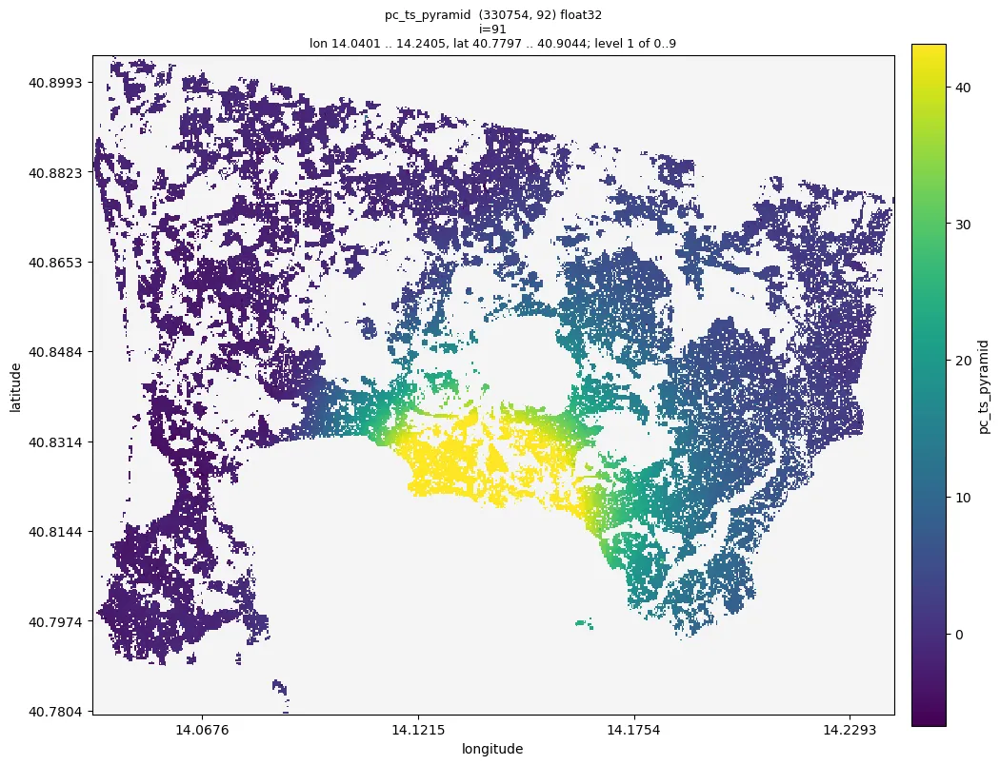
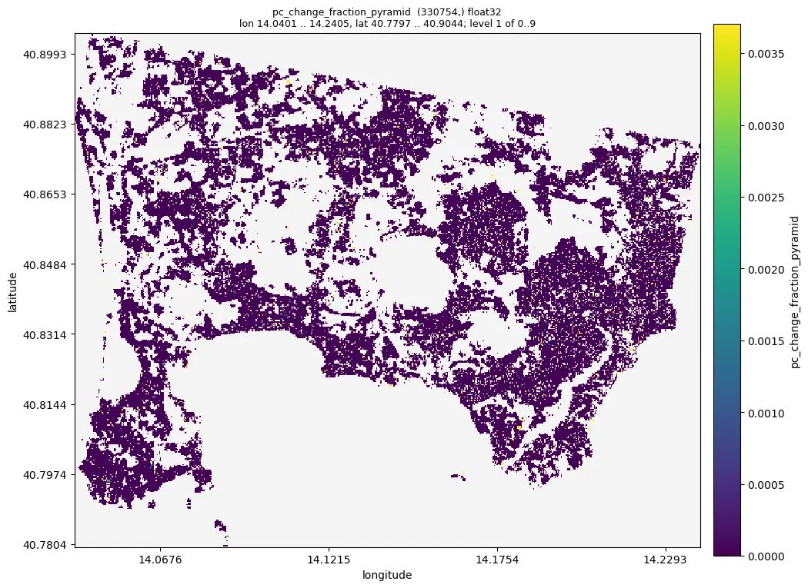

# 05 Phase unwrapping

Pipeline: `examples/05_unwrap.toml`. Tutorial: `nbs/Tutorials/CLI/CampiFlegrei/05_unwrap.ipynb`.
Needs `04_refine`.

```bash
moraine run examples/05_unwrap.toml --workdir WORK
```

Set `[vars] shape` to the (nlines, width) of `raw/rslc.zarr` and the pixel spacings to the ones of the
data (`range_pixel_spacing`, `azimuth_pixel_spacing` in meters, from a `*.rslc.par`); the defaults are the ones of
the sample data set (981 x 4160, 2.329562 m and 13.9516 m). The pixel spacings convert the grid index to meters.

## Steps

1. `pc-gix`: grid index of the refined points (from their hilbert index).
2. `image-pairs` with `bandwidth = 3`: every image with the next three (270 pairs for 92 images). The network
   closes loops of image pairs, e.g. (a, b), (b, c), (a, c), whose unwrapped phases must add up to zero.
3. `emcf-pc`: extended minimum cost flow (EMCF), the interferograms of the network unwrapped together on a
   Delaunay network of the points (decision 0020). `temporal_cost = "length"` (with `dates`, the acquisition
   dates) corrects the longest interferograms first where loops disagree; `spatial_cost = "weight"` (with
   `weight`, e.g. the temporal coherence) places phase jumps first at points of low quality, `spatial_cost =
   "length"` on long edges. Both costs are `constant` by default; on synthetic data with known truth
   (`tests/unwrap_benchmark.py`) the median share of wrong (point, interferogram) is 0.83 % against 1.54 % when
   every interferogram is unwrapped alone with `mcf-pc`.
4. `unwrap-correct-closure-pc`: where the loops do not add up to zero, every region (points connected without
   edges longer than 4 times the median edge length, e.g. a cluster or an island) is shifted by whole cycles in
   the interferograms that disagree with the majority (MintPy's phase closure correction, decision 0021); points
   of regions of fewer than 30 points are corrected one by one and marked -1 in `region`. Where the correction of
   its region does not close every loop of a point, the interferograms fitting most of its loops are kept. The
   result is the unwrapped phase of every image (decision 0022).
5. `pc-pyramid` of the image phases and of the change fraction on the map.

Outputs in `WORK/unw/`:

- `pc_unw.zarr` (n_points, n_pairs) float32: the unwrapped interferograms of the network in radians, in the
  order of `pairs_hop3.txt`.
- `pc_ts.zarr` (n_points, nimages) float32: the unwrapped phase of every image in radians relative to the first
  image (`ref`, its column is 0); interferogram (a, b) is `ts[:, a] - ts[:, b]`, so every loop closes. It has no
  spatial reference yet: compare points only relative to each other, or reference them in
  [06](06_products.md).
- `pc_misclosure_fraction.zarr`, `pc_change_fraction.zarr` (n_points,) float32, 0..1: the share of the
  interferograms of a point that did not fit the loops before the correction, and the share that the correction
  changed.
- `pc_region.zarr` (n_points,) int32: the region of every point, -1 for points of small regions.

## Expected results (sample data, Campi Flegrei, 330 754 points, 270 interferograms of 92 images)

| result | sample value | sane range |
|---|---|---|
| log of `closure` | loops do not close at 1.1 % of the points; 87 regions, 0.41 % of the points in smaller ones; the unwrapped phase changed at 1.1 % of the points, on average in 0.01 % of their interferograms | a few % of the points |
| `unw/pc_ts_pyramid` | p01 -6.7, p50 0.76, p99 43.1, min -28.1, max 84.3 (radians); warning "constant values: image 0" | image 0 is 0 everywhere (the reference image); a smooth uplift of tens of radians at Pozzuoli |
| `unw/pc_change_fraction_pyramid` | p50 0, p99 0.0037, max 0.074 | mostly 0; large values mark points whose unwrapping was poor |

Run time (CPU, 64 cores): `emcf-pc` 18.6 s, `unwrap-correct-closure-pc` 9.6 s, the two pyramids 9.3 s; 45 s and
3.8 GB peak memory for the pipeline.

Correctness check (in python): rewrapping gives the input phase, `np.angle(np.exp(1j * ts[:, j]) * np.conj(ph[:, j]
* np.conj(ph[:, 0])))` near 0 (sample: max 3.9e-06 rad), and the same for `pc_unw` and its image pairs (max
1.8e-06 rad).

Large data: 10 million points, 100 images, 294 interferograms: `emcf-pc` takes 13 min with 4 interferograms at
the same time (8.2 GB peak memory) and 6 min with 32 (51 GB; the default on a 32 core machine is bounded by the
cores and half of the available memory); `unwrap-correct-closure-pc` takes 145 s and 3.3 GB. `ph` must be chunked
one image per chunk (`docs/contracts/data.md`).

## Figures

Quicklooks of the sample data run of 2026-10-19 (the numbers above are from the same run):



*Unwrapped phase of the last image (2021-12-29) relative to the first one (2019-01-02), `unw/pc_ts_pyramid
--index 91`: the uplift of Pozzuoli, tens of radians, smooth across the scene; the colours span the 1 % - 99 %
range of all images. Without a spatial reference the level of the whole map is arbitrary.*



*Change fraction, `unw/pc_change_fraction_pyramid`: 0 at almost all points; the few points where the correction
changed interferograms are scattered, not clustered in one area.*

## Checks

- `moraine info unw/pc_ts_pyramid`: only the warning for image 0; values within a few tens of radians.
- `moraine quicklook unw/pc_ts_pyramid --index I -o ts.png`: smooth, no isolated jumps of 2 pi between
  neighbouring areas. The Delaunay network connects all points, so point clusters separated by large gaps (water,
  vegetation) are linked by long edges, where errors of whole cycles between clusters are most likely; such
  clusters are separate regions of the closure correction.
- `moraine quicklook unw/pc_change_fraction_pyramid`: mostly 0. `change_fraction` is the point quality of this
  step for masking: on synthetic data with known truth it separated points wrong in at least one interferogram from
  right ones better than `misclosure_fraction` (area under the ROC curve 0.55-0.96). The threshold depends on the
  data; there is no default.
- No measure of this step sees errors that close every loop, e.g. the same whole cycles in every interferogram of
  one image (0.4-9 % of the points without any misclosure were wrong after `emcf-pc` on the synthetic data), or
  whole cycles between regions: combine it with the phase quality (temporal coherence) of the points. It relies on
  most interferograms of a region being right, so look at the quicklooks.

## Alternative: sequential interferograms with MCF

`mcf-pc` unwraps every interferogram alone, e.g. the sequential pairs (`image-pairs` with `bandwidth = 1`): faster
(sample data: 1.7 s for 91 interferograms) but without loops, so unwrapping errors are neither corrected nor
detected. `gamma-mcf-pt` uses GAMMA's `mcf_pt` instead and takes e/n. The closure correction also accepts their
results to get the phase of every image; without loops it only adds up the interferograms (a warning is given).

```toml
[[step]]
name = "pairs_seq"
run = "image-pairs"
rslc = "pc/pc_ph.zarr"
bandwidth = 1
out = "unw/pairs_seq.txt"

[[step]]
name = "unwrap_mcf"
run = "mcf-pc"
gix = "unw/pc_gix.zarr"
ph = "pc/pc_ph.zarr"
unw_ph = "unw/pc_unw_seq.zarr"
image_pairs = "unw/pairs_seq.txt"
range_pixel_spacing = "${range_pixel_spacing}"
azimuth_pixel_spacing = "${azimuth_pixel_spacing}"
```

## Problems

- The unwrapping needs unique points (unique gix); the refined points from `04_refine` are unique.
- Unwrapping errors along gaps: more points (lower thresholds in 02-04) make the network denser.
- Images decorrelated by snow or strong changes break the loops of their interferograms: see the roadmap item on
  the detection of decorrelated images (`docs/roadmap.md`).
