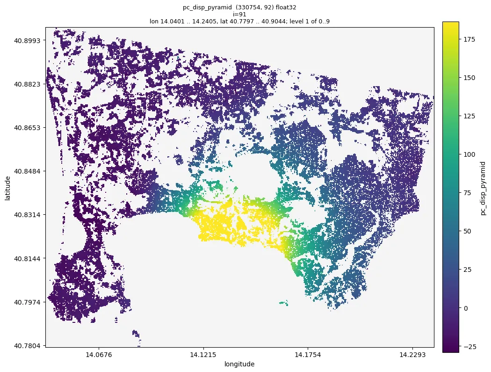

# 06 Deformation products

Pipeline: `examples/06_products.toml`. Tutorial: `nbs/Tutorials/CLI/CampiFlegrei/06_products.ipynb`.
Needs `04_refine` and `05_unwrap`. The steps and conventions are decision 0040.

```bash
moraine run examples/06_products.toml --workdir WORK
```

Set `[vars] ref_area` to a reference area of the data (a numexpr expression of `lon` and `lat`, the longitude and
latitude of the points) and `wavelength` to the radar wavelength in meters (`radar_wavelength` of
`raw/meta.toml`); the defaults are the ones of the sample data set (a box east of the caldera, Sentinel-1
0.0554658 m).

## Steps

1. `math`: the reference points, a bool mask of the points inside `ref_area`. A polygon drawn on a map
   (`mc.view(..., polygons='reference.geojson')`, or written with `moraine.write_polygons`) works too:

   ```toml
   [[step]]
   name = "ref_mask"
   run = "polygon-mask"
   polygons = "reference.geojson"
   x = "pc/pc_lon.zarr"
   y = "pc/pc_lat.zarr"
   mask = "disp/pc_ref_mask.zarr"
   ```

2. `pc-reference`: from every image the median of the reference points is subtracted, so that it is 0 in every
   image; `method = "mean"` takes their mean, `ref_point` (instead of `ref_mask`) one point, e.g. the point of a
   double click on a map. The median is not moved by a few reference points with unwrapping errors.
3. `pc-disp`: line of sight displacement in millimeters, `1000 * wavelength / (4 pi)` per radian (4.41 mm for
   Sentinel-1), positive towards the satellite (a shorter range).
4. `pc-pyramid` of the displacement on the map.

Outputs in `WORK/disp/`:

- `pc_ref_mask.zarr` (n_points,) bool: the reference points.
- `pc_ts_ref.zarr` (n_points, nimages) float32: the unwrapped phase of every image relative to the first image
  and to the reference area, in radians.
- `ref_value.zarr` (nimages,) float32: the value subtracted from every image, in radians.
- `pc_disp.zarr` (n_points, nimages) float32: the line of sight displacement in millimeters relative to the first
  image and to the reference area, positive towards the satellite. It is along the line of sight, not vertical: a
  vertical motion u gives about u cos(incidence) (incidence about 35 degrees on the sample data), plus a share of
  the horizontal motion.

## The reference area

The displacements are relative to the reference area, so its own motion is in every point. Take an area that is
stable (outside the deforming area), coherent (many refined points), not affected by strong local atmosphere, close
to the area of interest and at a similar height (MintPy's guidelines), and inside one region of the closure
correction (`unw/pc_region.zarr`): points of other regions can be off by whole cycles in some images, which the
loops do not detect. Check the regions of the reference points in python:

```python
import numpy as np, zarr
region = zarr.open('unw/pc_region.zarr', mode='r')[:]
ref = zarr.open('disp/pc_ref_mask.zarr', mode='r')[:]
np.unique(region[ref], return_counts=True)
```

The sample scene is small: every part of it is within about 10 km of Pozzuoli, so no area is far from the uplift.
The default box east of the caldera (Naples, 8-13 km from Pozzuoli) has 11 131 points, 99.7 % of them in the
region of Pozzuoli, and is flat inside (its points 9-10, 10-11 and 11-13 km from Pozzuoli differ by less than
1 mm in the last image). Areas in the north-west and the north of the scene move by 12-15 mm less than it over the
three years, and only 49 % (north-west) and 76 % (north) of their points are in that region; with them as reference
all displacements shift by that much. Which area is stable is not known from the data alone (GNSS stations would
tell).

## Expected results (sample data, Campi Flegrei, 330 754 points, 92 images)

| result | sample value | sane range |
|---|---|---|
| log of `ref_mask` | 11 131 reference points | thousands of points |
| log of `reference` | reference values min -3.5, median 0.31, max 5.2 (radians) | the level of every image, a few radians |
| `disp/pc_disp_pyramid` | p01 -29.3, p50 1.1, p99 186.2, min -131, max 370 (mm); warning "constant values: image 0" | image 0 is 0 everywhere; the uplift of Pozzuoli positive, about 0 in the reference area |
| Pozzuoli (points within 500 m of Rione Terra), median | 0, 24, 75, 90, 141, 205, 255 mm on 2019-01-02, 2019-07-01, 2019-12-28, 2020-06-25, 2020-12-22, 2021-06-20, 2021-12-29 | growing, towards the satellite |
| reference points in the last image | median 0, median absolute deviation 2.7 mm, 90 % within 7.8 mm | a few mm |

Run time: `pc-reference` 1.0 s, `pc-disp` 0.8 s, the pyramid 4.2 s; 9.6 s and 0.66 GB peak memory for the
pipeline. Large data (10 million points, 92 images, 4 threads): `pc-reference` 10.3 s and 0.9 GB, `pc-disp`
15.5 s and 0.97 GB.

## Figures

Quicklook of the sample data run of 2026-10-19 (the numbers above are from the same run):



*Line of sight displacement on 2021-12-29 relative to 2019-01-02 and to the box east of the caldera,
`disp/pc_disp_pyramid --index 91`: the uplift of Pozzuoli, up to 360 mm towards the satellite about 1 km east of
Rione Terra; the colours span the 1 % - 99 % range of all images, so the centre is saturated.*

## Checks

- `moraine info disp/pc_disp_pyramid`: only the warning for image 0; values within a few hundred millimeters.
- `moraine quicklook disp/pc_disp_pyramid --index I -o disp.png`: about 0 in the reference area, smooth; the
  sign of a known motion right (uplift: positive).
- `moraine view disp/pc_disp_pyramid --dates raw/meta.toml -o view.ipynb`: click points for their displacement
  time series.

## Problems

- `pc-reference` fails with "no value (all nan)": the reference points have no data in an image; take another
  area.
- `pc-disp` fails with "between 0 and 1": the wavelength is not in meters (e.g. 5.55 in centimeters).
- Jumps of about 27.7 mm (half a wavelength for Sentinel-1) between areas or dates are whole cycles of unwrapping
  errors: check the regions and the change fraction of `05_unwrap`.
- The DEM error, the velocity and the residual of every image are not computed yet (decision 0040, later steps).
