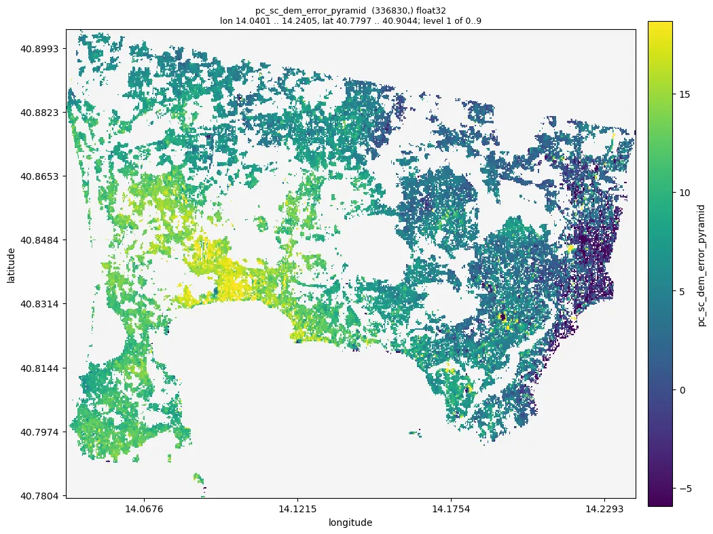

# 06 Deformation products

Pipeline: `examples/06_products.toml`. Tutorial: `nbs/Tutorials/CLI/CampiFlegrei/06_products.ipynb`.
Needs `04_refine`, `05_unwrap` and the network for ERA5 (see [The troposphere](#the-troposphere)). The steps and
conventions are decision 0048, the troposphere decision 0051.

```bash
moraine run examples/06_products.toml --workdir WORK
```

Set `[vars] ref_area` to a reference area of the data (an expression of `lon` and `lat` in the syntax of `math`, the longitude and
latitude of the points); the default is the one of the sample data set (a box east of the caldera). Set `geoid` to
the height of the geoid above the WGS84 ellipsoid at the scene in meters, 0 if the heights of the DEM are above the
geoid (see [The troposphere](#the-troposphere)); 46 m for the sample data. The radar wavelength in meters
(`wavelength`, 0.0554658 m for Sentinel-1), the dates of the images (`dates`), their UTC times (`times`) and the
longitude / latitude box of the DEM (`lonlat_bbox`) are read from `raw/meta.toml` of `01_load`.

## Steps

1. `pc-disp`: line of sight displacement in millimeters from the unwrapped phase of every image (`unw/pc_ts.zarr`,
   relative to the first image), `1000 * wavelength / (4 pi)` per radian (4.41 mm for Sentinel-1), positive towards
   the satellite (a shorter range).
2. `download-era5`: the ERA5 pressure levels of the whole hours around the time of every image into `WORK/era5/`,
   one file per hour, from the NSF NCAR archive of ERA5 on AWS (no account) or, with `source = "cds"`, from the
   Copernicus Climate Data Store; files already there are kept, so a rerun continues an interrupted download.
3. `pc-tropo-era5`: the displacement the troposphere causes at every point in every image relative to the first
   image, from ERA5 at the height of the point.
4. `math`: the displacement without it, `disp - tropo`.
5. `math`: the reference points, a bool mask of the points inside `ref_area`. A polygon drawn on a map
   (`mc.view(..., polygons='reference.geojson')`, or written with `moraine.write_polygons`) works too:

   ```toml
   [[step]]
   name = "ref_mask"
   run = "polygon-mask"
   polygons = "reference.geojson"
   x = "pc/pc_lon.zarr"
   y = "pc/pc_lat.zarr"
   mask = "disp/pc_ref_mask.zarr"
   ```

6. `pc-reference`: from every image the median of the reference points is subtracted, so that it is 0 in every
   image; `method = "mean"` takes their mean, `ref_point` (instead of `ref_mask`) one point, e.g. the point of a
   double click on a map. The median is not moved by a few reference points with unwrapping errors.
7. `pc-sc-dem-error`: the spatially correlated DEM error of every point, from the perpendicular baselines of the
   point (`pc/pc_bperp.zarr` of `04_refine`), and the displacement without it; `math` adds the DEM error relative to
   the neighbourhood of `04_refine`: the whole DEM error, the height of the scatterer above the DEM of the processing
   (see [The DEM error](#the-dem-error)).
8. `pc-pyramid` of the displacement, the troposphere, the two DEM errors and the displacement without the DEM error
   on the map.

Outputs in `WORK/era5/`: `era5_YYYYMMDD_HH.nc`, the geopotential, temperature and specific humidity of ERA5 on its
37 pressure levels over the scene for the hour (UTC), two hours per image. In `WORK/disp/`:

- `pc_disp_unref.zarr` (n_points, nimages) float32: the line of sight displacement in millimeters relative to the
  first image, positive towards the satellite.
- `pc_tropo.zarr` (n_points, nimages) float32: the line of sight displacement in millimeters that the troposphere
  causes, relative to the first image: minus the change of the tropospheric delay, positive where the delay is
  smaller than in the first image.
- `pc_disp_tropocor.zarr` (n_points, nimages) float32: `pc_disp_unref.zarr` minus `pc_tropo.zarr`.
- `pc_ref_mask.zarr` (n_points,) bool: the reference points.
- `ref_value.zarr` (nimages,) float32: the value subtracted from every image, in millimeters.
- `pc_disp.zarr` (n_points, nimages) float32: the line of sight displacement in millimeters relative to the first
  image and to the reference area, corrected for the troposphere, positive towards the satellite. It is along the line of sight, not vertical: a
  vertical motion u gives about u cos(incidence) (incidence about 35 degrees on the sample data), plus a share of
  the horizontal motion.
- `pc_sc_dem_error.zarr` (n_points,) float32: the spatially correlated DEM error in meters, positive above the DEM,
  relative to the reference area.
- `pc_dem_error.zarr` (n_points,) float32: the whole DEM error in meters, `pc/pc_su_dem_error.zarr` of `04_refine`
  plus `pc_sc_dem_error.zarr`.
- `pc_disp_demcor.zarr` (n_points, nimages) float32: `pc_disp.zarr` without the spatially correlated DEM error term,
  in millimeters (the part relative to the neighbourhood was removed before the unwrapping): the displacement
  without the DEM error.

## The reference area

The displacements are relative to the reference area, so its own motion is in every point. Take an area that is
stable (outside the deforming area), coherent (many refined points), not affected by strong local atmosphere, close
to the area of interest and at a similar height (MintPy's guidelines), and inside one region of the closure
correction (`unw/pc_region.zarr`): points of other regions can be off by whole cycles in some images, which the
loops do not detect. Check the regions of the reference points in python:

```python
import numpy as np, zarr
region = zarr.open('unw/pc_region.zarr', mode='r')[:]
ref = zarr.open('disp/pc_ref_mask.zarr', mode='r')[:]
np.unique(region[ref], return_counts=True)
```

The sample scene is small: every part of it is within about 10 km of Pozzuoli, so no area is far from the uplift.
The default box east of the caldera (Naples, 8-13 km from Pozzuoli) has 11 829 points, 99.7 % of them in the
region of Pozzuoli, and is flat inside (its points 9-10, 10-11 and 11-13 km from Pozzuoli differ by less than
1 mm in the last image). Areas in the north-west and the north of the scene move by 12-15 mm less than it over the
three years, and only 49 % (north-west) and 76 % (north) of their points are in that region; with them as reference
all displacements shift by that much. Which area is stable is not known from the data alone (GNSS stations would
tell).

## The troposphere

The delay of the radar signal in the troposphere changes from image to image: by centimeters, partly with the
height of the ground (stratified: dry and moist air of different depth over the valleys and over the mountains),
partly in patterns of a few kilometers (turbulent). `pc-tropo-era5` takes the stratified part and the large scale
from ERA5, the hourly reanalysis of ECMWF on a 0.25 degree grid (about 25 km) with 37 pressure levels: the delay of
the air above every point in the two whole hours around the time of the image, interpolated to the time, divided by
the sine of the elevation of the look vector. ERA5 does not resolve the turbulent part; it stays in the displacement
(decision 0048, step 8, later).

`download-era5` takes ERA5 from one of two places (`source`):

- `ncar` (the default): the NSF NCAR archive of ERA5 on AWS (https://registry.opendata.aws/nsf-ncar-era5), without an
  account. It stores the fields of the whole earth by hour, so about 170 MB go over the network for every hour; on the
  sample data 31 GB for its 184 hours, in about 15 minutes with the four worker processes of the example (`n_workers`;
  eight took 10 minutes; a worker holds about 250 MB). It follows ERA5 by about three months.
- `cds`: the Copernicus Climate Data Store, which sends the area only (52 kB per hour) but lets every hour wait in its
  queue: about a minute each, 55 minutes for the sample data. For a slow network, for the last months, or for the
  original source. It needs your own account, set up once:

  1. register at https://cds.climate.copernicus.eu;
  2. on the page of the dataset "ERA5 hourly data on pressure levels from 1940 to present", tab "Download", accept the
     licence (Terms of use) at the end;
  3. write the URL and the API key of your profile page into `~/.cdsapirc`, two lines (a key with a number and a colon
     in front, `12345:...`, and the URL `.../api/v2` are of the old Data Store and are refused):

     ```text
     url: https://cds.climate.copernicus.eu/api
     key: <your API key>
     ```

Both need the package h5py, the Climate Data Store also cdsapi: `pip install 'moraine[era5]'`. On a node without the
network, run the pipeline once where the network is, or copy the files into `WORK/era5/`: files that hold their hour
over the area are kept, and nothing is downloaded then.

The heights of the levels of ERA5 are above the geoid (mean sea level); `pc-tropo-era5` takes `hgt - geoid` as the
height of a point above the geoid. The heights of the DEM of the processing (`raw/hgt.zarr` of `01_load`, from GAMMA)
are above the WGS84 ellipsoid when the DEM was imported with the geoid (GAMMA `dem_import` with a geoid model), above
the geoid otherwise: the sea shows which, at about the height of the geoid (`moraine info raw/hgt.zarr`, the minimum
over the sea), or at 0. A wrong `geoid` shifts the delay of every point by about the same amount, which the reference
area removes; what is left grows with the relief: about 1.5 mm in an image for the 450 m of the sample data with a
geoid of 46 m left out, less than 1 mm between images, a few millimeters over 3 km of relief.

`disp/pc_tropo.zarr` is mostly one value per image, the change of the delay of the whole troposphere above the
scene (in the sample data -72 mm in the median, down to -241 mm in summer, relative to 2019-01-02), which the
reference area removes with the unknown level of every image. What is left varies over the scene: on the sample data
1.9 mm (standard deviation over the points, median of the images), at most 7.9 mm (2020-08-12, see the figure),
with -1.6 to 6.2 mm per 100 m of height (5 % - 95 % of the images). On the 12 day differences of the displacement,
mostly atmosphere, the correction reduces the dependence on height (root mean square of the slopes 2.64 to 2.04 mm
per 100 m) but little else: the standard deviation over the points goes from 4.49 to 4.40 mm (median of the 91
pairs); it is smaller in 60 % of the pairs, and in the worst 10 % of the pairs the variance grows by more than half.
The points of the sample data cover 17 by 14 km, less than a cell of ERA5, with 450 m of relief, so the turbulent
atmosphere, which ERA5 does not resolve, dominates; scenes with more relief and larger extent gain more. The median
displacement of Pozzuoli changes by up to 17 mm.

## The DEM error

A scatterer dh meters above the DEM of the processing (a roof on a terrain model, a wall above the ground) shifts the
displacement of image k by c_k dh, c_k = 1000 B_perp,k / (R cos(theta)) mm per meter (B_perp,k the perpendicular
baseline of the point, R its slant range, theta the elevation of its look vector): on the sample data about
0.2 mm per meter for 100 m of baseline. The DEM error is estimated in two parts (decision 0048). The part relative to
the neighbourhood in the filtered interferograms (a roof above the ground around it, `pc/pc_su_dem_error.zarr`)
was fitted in the temporal coherence of `04_refine` and removed from the phase before the unwrapping.
`pc-sc-dem-error` fits the rest, the spatially correlated part, from the differences of the displacement between
neighbouring dates, with a constant velocity besides: a deformation that changes slowly from one date to the next,
as the accelerating uplift of Pozzuoli, does not get into it (its smooth part, polynomials of degree 2 to 5, less
than 0.3 m). The dates come from `raw/meta.toml`; they must be those of the images, in order. The `math` step adds
the two parts; they agree with the DEM error estimated in one part from the displacement (correlation 0.998).

The part relative to the neighbourhood is about 0 on average everywhere (median 0.0 m, 1.0 m median absolute
deviation) and is the one to trust for single buildings; it is about 15 % smaller than the local DEM error where
many points lie on one building, and the rest is in the spatially correlated part. The spatially correlated part
is relative to the reference area (the reference subtracted the displacement of its points, their DEM error
included): 0.25 m there. Estimated from the odd and from the even dates of the sample data separately, its 1 km
means agree poorly: atmosphere that correlates by chance with the baselines of the images gives patterns of several
meters over kilometers (without the troposphere correction 0 m east, at the reference, to 11 m west and 16 m at
Pozzuoli). The correlation of the two halves is 0.42 with the troposphere from ERA5, 0.27 without it; the
turbulent atmosphere is left (decision 0048, step 8, later). With the small baselines of Sentinel-1 the correction
of the DEM error changes the displacements by a few millimeters.

## Expected results (sample data, Campi Flegrei, 336 830 points, 92 images)

| result | sample value | sane range |
|---|---|---|
| log of `ref_mask` | 11 829 reference points | thousands of points |
| log of `era5` | 92 images need 184 hours of ERA5, area (north, west, south, east) [41.25, 13.75, 40.5, 14.5] | two hours per image (one if an image is at a whole hour); the area around `lonlat_bbox` |
| log of `tropo` | ERA5 grid: 4 x 4 nodes, 37 levels; standard deviation of the troposphere over the points per image: median 1.9 mm, max 7.9 mm (image 49) | millimeters to a few centimeters; tens of centimeters: wrong heights or `geoid` |
| `disp/pc_tropo_pyramid` | p01 -221.7, p50 -72.4, p99 39.6, min -241, max 44 (mm); warning "constant values: image 0" | image 0 is 0; mostly one value per image (see [The troposphere](#the-troposphere)) |
| log of `reference` | reference values min -48.1, median 71.2, max 226.7 (mm) | the level of every image, including the change of the delay over the whole scene |
| `disp/pc_disp_pyramid` | p01 -26.5, p50 2.2, p99 187.3, min -112, max 370 (mm); warning "constant values: image 0" | image 0 is 0 everywhere; the uplift of Pozzuoli positive, about 0 in the reference area |
| Pozzuoli (the 662 points within 500 m of Rione Terra, 40.8197 N 14.1203 E), median | 0, 28, 75, 92, 142, 207, 253 mm on 2019-01-02, 2019-07-01, 2019-12-28, 2020-06-25, 2020-12-22, 2021-06-20, 2021-12-29 | growing, towards the satellite |
| reference points in the last image | median 0, median absolute deviation 3.0 mm, 90 % within 8.3 mm | a few mm |
| log of `sc_dem_error` | 92 images from 20190102 to 20211229 (1092 days); dh of 336 830 points (0 nan): percentiles 1, 50, 99 -6.80, 6.19, 17.79 m | all dates; no nan; meters to tens of meters |
| `disp/pc_sc_dem_error_pyramid` | p01 -6.8, p50 6.2, p99 17.8, min -54, max 76 (m) | the large scale atmosphere (see above); hundreds of meters: a wrong `bperp` or wrong dates |
| spatially correlated DEM error of the reference points | median 0.25 m, median absolute deviation 2.7 m | about 0 |
| `disp/pc_dem_error_pyramid` (the whole DEM error) | p01 -10.3, p50 6.2, p99 21.2, min -65, max 82 (m) | buildings and the large scale atmosphere |
| `disp/pc_disp_demcor_pyramid` | p01 -26.2, p50 2.2, p99 187.5, min -112, max 368 (mm); warning "constant values: image 0" | that of `pc_disp_pyramid` within a few mm |
| Pozzuoli without the DEM error | 0, 26, 73, 93, 143, 208, 255 mm: the median changes by at most 3.3 mm | a few mm |

Run time: `download-era5` from the NSF NCAR archive 6.1 s per day with the four worker processes, about 9.5 minutes
for the 92 days (from the Climate Data Store, hour by hour, about 55 minutes); `pc-tropo-era5` 2.6 s, `math` 5.2 and
0.1 s, `pc-reference` 1.1 s, `pc-disp` 0.9 s, `pc-sc-dem-error` 1.3 s, the five pyramids 6.4, 5.1, 1.5, 1.6 and 4.5 s;
1.6 GB peak memory for the pipeline. Large data (10 million points, 92 images, 4 threads):
`pc-reference` 10.3 s and 0.9 GB, `pc-disp` 15.5 s and 0.97 GB, `pc-tropo-era5` 28.8 s and 0.92 GB (184 hours of
ERA5; 16 threads: 32.6 s, 2.35 GB), `pc-sc-dem-error` 27 s and 3.4 GB (16 threads: 28 s, 9.4 GB; the reading and
writing of the chunks limit it).

## Figures

Quicklooks of the sample data runs of 2026-10-19 (the displacement, with 1.8 % fewer points and without the
troposphere; the map looks the same), 2026-11-15 (the DEM error, before the troposphere) and 2026-11-15 with the
troposphere (the numbers above are from this run):


*The displacement the troposphere causes on 2020-08-12 relative to 2019-01-02, `disp/pc_tropo_pyramid --index 49
--clim -185,-140`: -168 mm over the whole scene (more water vapour in August), 7.3 mm per 100 m less on the hills,
where there is less air above the points, and about 10 mm from west to east (height and a plane explain 99 % of
it).*


*Line of sight displacement on 2021-12-29 relative to 2019-01-02 and to the box east of the caldera,
`disp/pc_disp_pyramid --index 91`: the uplift of Pozzuoli, up to 360 mm towards the satellite about 1 km east of
Rione Terra; the colours span the 1 % - 99 % range of all images, so the centre is saturated.*



*Spatially correlated DEM error relative to the box east of the caldera, `disp/pc_sc_dem_error_pyramid`: about 0 in
the box, rising to 10 - 20 m towards Pozzuoli and the west. These kilometer scale patterns do not repeat between the
odd and the even dates (atmosphere through the baselines); the buildings are in the part relative to the
neighbourhood of `04_refine`.*

## Checks

- `moraine info disp/pc_disp_pyramid`: only the warning for image 0; values within a few hundred millimeters.
- `moraine quicklook disp/pc_disp_pyramid --index I -o disp.png`: about 0 in the reference area, smooth; the
  sign of a known motion right (uplift: positive).
- `moraine view disp/pc_disp_pyramid --dates raw/meta.toml -o view.ipynb`: click points for their displacement
  time series.
- `moraine quicklook disp/pc_sc_dem_error_pyramid -o dh.png`: about 0 in the reference area; smooth patterns of
  several meters over kilometers are atmosphere. `pc/pc_su_dem_error_pyramid` of `04_refine`: buildings stand out
  from their surroundings.

## Problems

- `pc-reference` fails with "no value (all nan)": the reference points have no data in an image; take another
  area.
- `pc-disp` fails with "between 0 and 1": the wavelength is not in meters (e.g. 5.55 in centimeters).
- `download-era5` fails with "is not in the NSF NCAR archive": the images are more recent than its copy of ERA5; set
  `source = "cds"` in the `era5` step. With `source = "cds"`: "no API key": `~/.cdsapirc` is missing; "API endpoint
  not found": `~/.cdsapirc` is of the old Data Store (see [The troposphere](#the-troposphere)); an error about the
  licence: accept the licence of the dataset on its page. A connection error: the node has no network.
- `pc-tropo-era5` fails with "no ERA5 file": the `era5` step did not finish; with "outside the grid": the files are of
  another area (delete `WORK/era5/` and run again).
- `pc-tropo-era5` fails with "geoid": the value is not in meters; with "elevation angle": `theta` is not the elevation
  of the look vector in radians.
- Jumps of about 27.7 mm (half a wavelength for Sentinel-1) between areas or dates are whole cycles of unwrapping
  errors: check the regions and the change fraction of `05_unwrap`.
- `pc-sc-dem-error` fails with "N dates for M images" or "must increase": the dates are not those of the images of
  the stack; with "bperp must have shape": `pc/pc_bperp.zarr` is not of these points (rerun `04_refine`);
  `pc/pc_bperp.zarr` missing: the working directory was made before the `bperp` step of `01_load`.
- The velocity and the residual of every image are not computed yet (decision 0048, later steps).
