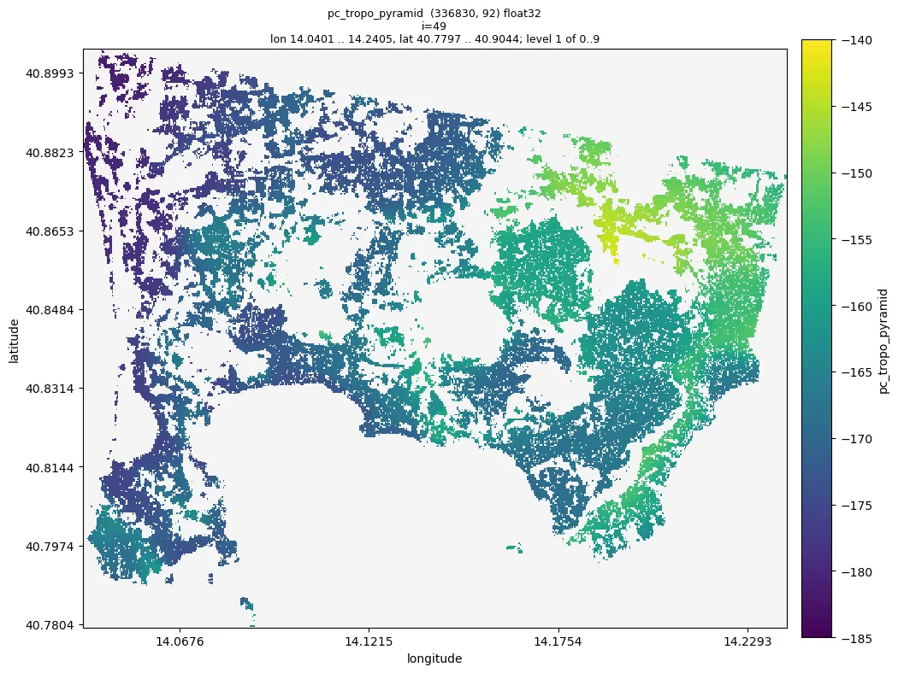
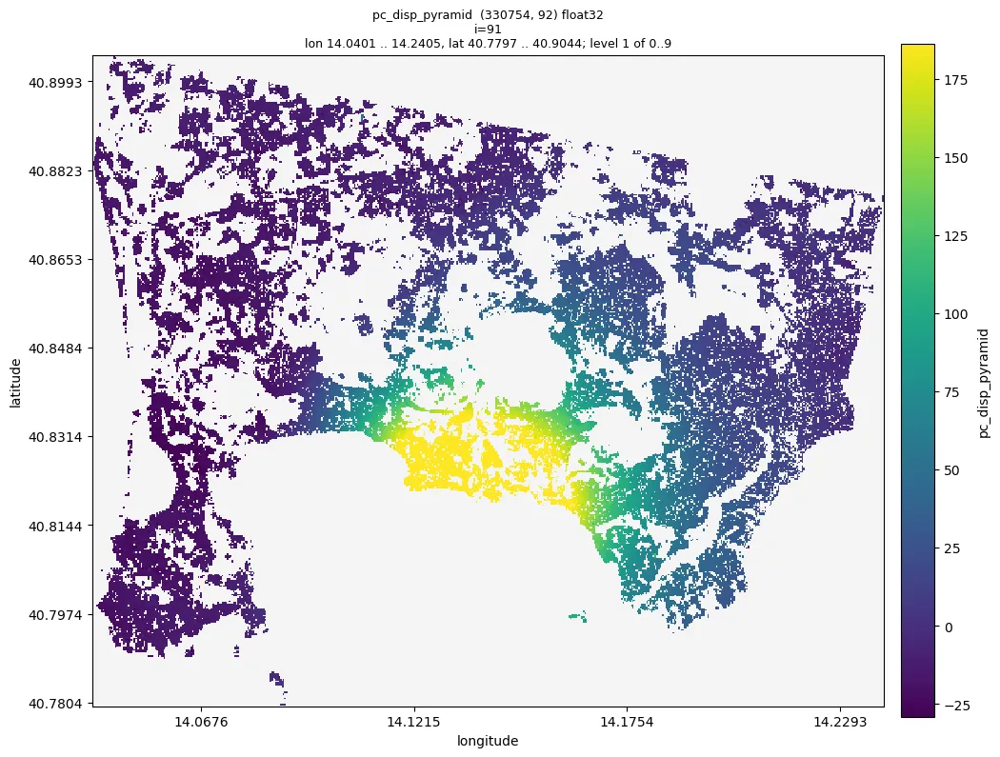
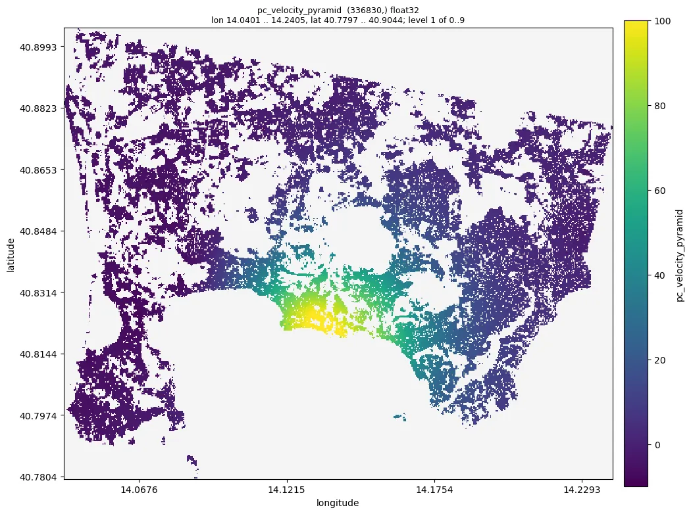

# 06 Deformation products

Pipeline: `examples/06_products.toml`. Tutorial: `nbs/Tutorials/CLI/CampiFlegrei/06_products.ipynb`.
Needs `04_refine`, `05_unwrap` and the network for ERA5 (see [The troposphere](#the-troposphere)). The steps and
conventions are decision 0048, the troposphere decision 0051, the velocity decision 0054, the export decision 0055.

```bash
moraine run examples/06_products.toml --workdir WORK
```

Set `[vars] ref_area` to a reference area of the data (an expression of `lon` and `lat` in the syntax of `math`, the longitude and
latitude of the points); the default is the one of the sample data set (a box east of the caldera). Set `geoid` to
the height of the geoid above the WGS84 ellipsoid at the scene in meters, 0 if the heights of the DEM are above the
geoid (see [The troposphere](#the-troposphere)); 46 m for the sample data. The radar wavelength in meters
(`wavelength`, 0.0554658 m for Sentinel-1), the dates of the images (`dates`), their UTC times (`times`) and the
longitude / latitude box of the DEM (`lonlat_bbox`) are read from `raw/meta.toml` of `01_load`. `era5_dir` is the
directory of the ERA5 files, `era5` in the working directory by default; working directories of the same scene can
share one, so that ERA5 is downloaded once (see [The troposphere](#the-troposphere)).

## Steps

1. `pc-disp`: line of sight displacement in millimeters from the unwrapped phase of every image (`unw/pc_ts.zarr`,
   relative to the first image), `1000 * wavelength / (4 pi)` per radian (4.41 mm for Sentinel-1), positive towards
   the satellite (a shorter range).
2. `download-era5`: the ERA5 pressure levels of the whole hours around the time of every image into `WORK/era5/`
   (`era5_dir`), one file per hour, from the NSF NCAR archive of ERA5 on AWS (no account) or, with
   `source = "cds"`, from the Copernicus Climate Data Store; files already there are kept, so a rerun continues an
   interrupted download.
3. `pc-tropo-era5`: the displacement the troposphere causes at every point in every image relative to the first
   image, from ERA5 at the height of the point.
4. `math`: the displacement without it, `disp - tropo`.
5. `math`: the reference points, a bool mask of the points inside `ref_area`. A polygon drawn on a map
   (`mc.view(..., polygons='reference.geojson')`, or written with `moraine.write_polygons`) works too:

   ```toml
   [[step]]
   name = "ref_mask"
   run = "polygon-mask"
   polygons = "reference.geojson"
   x = "pc/pc_lon.zarr"
   y = "pc/pc_lat.zarr"
   mask = "disp/pc_ref_mask.zarr"
   ```

6. `pc-reference`: from every image the median of the reference points is subtracted, so that it is 0 in every
   image; `method = "mean"` takes their mean, `ref_point` (instead of `ref_mask`) one point, e.g. the point of a
   double click on a map. The median is not moved by a few reference points with unwrapping errors.
7. `pc-sc-dem-error`: the spatially correlated DEM error of every point, from the perpendicular baselines of the
   point (`pc/pc_bperp.zarr` of `04_refine`), and the displacement without it; `math` adds the DEM error relative to
   the neighbourhood of `04_refine`: the whole DEM error, the height of the scatterer above the DEM of the processing
   (see [The DEM error](#the-dem-error)).
8. `pc-velocity`: the velocity of every point, a straight line in time fitted to the displacement without the DEM
   error over the dates not in `[vars] exclude` (none by default), its standard deviation and the residual RMS of
   every point and of every image (see [The velocity](#the-velocity)).
9. `pc-export`: the points with their velocity, the displacement without the DEM error and more in a GeoPackage
   file for GIS software (see [The points in GIS software](#the-points-in-gis-software)).
10. `pc-pyramid` of the displacement, the troposphere, the two DEM errors, the displacement without the DEM error,
    the velocity, its standard deviation and the residual RMS of the points on the map.

Outputs in `WORK/era5/` (`era5_dir`): `era5_YYYYMMDD_HH.nc`, the geopotential, temperature and specific humidity of
ERA5 on its 37 pressure levels over the scene for the hour (UTC), two hours per image. In `WORK/disp/`:

- `pc_disp_unref.zarr` (n_points, nimages) float32: the line of sight displacement in millimeters relative to the
  first image, positive towards the satellite.
- `pc_tropo.zarr` (n_points, nimages) float32: the line of sight displacement in millimeters that the troposphere
  causes, relative to the first image: minus the change of the tropospheric delay, positive where the delay is
  smaller than in the first image.
- `pc_disp_tropocor.zarr` (n_points, nimages) float32: `pc_disp_unref.zarr` minus `pc_tropo.zarr`.
- `pc_ref_mask.zarr` (n_points,) bool: the reference points.
- `ref_value.zarr` (nimages,) float32: the value subtracted from every image, in millimeters.
- `pc_disp.zarr` (n_points, nimages) float32: the line of sight displacement in millimeters relative to the first
  image and to the reference area, corrected for the troposphere, positive towards the satellite. It is along the line of sight, not vertical: a
  vertical motion u gives about u cos(incidence) (incidence about 35 degrees on the sample data), plus a share of
  the horizontal motion.
- `pc_sc_dem_error.zarr` (n_points,) float32: the spatially correlated DEM error in meters, positive above the DEM,
  relative to the reference area.
- `pc_dem_error.zarr` (n_points,) float32: the whole DEM error in meters, `pc/pc_su_dem_error.zarr` of `04_refine`
  plus `pc_sc_dem_error.zarr`.
- `pc_disp_demcor.zarr` (n_points, nimages) float32: `pc_disp.zarr` without the spatially correlated DEM error term,
  in millimeters (the part relative to the neighbourhood was removed before the unwrapping): the displacement
  without the DEM error.
- `pc_velocity.zarr` (n_points,) float32: the line of sight velocity in millimeters per year, positive towards the
  satellite, relative to the reference area.
- `pc_velocity_std.zarr` (n_points,) float32: its standard deviation in millimeters per year, from the residuals.
- `pc_residual_rms.zarr` (n_points,) float32: the root mean square of the residuals of every point over the fitted
  dates, in millimeters: how far the displacement is from a straight line.
- `image_rms.zarr` (nimages,) float32: the root mean square of the residuals of every image over the points, in
  millimeters, the excluded dates included.
- `points.gpkg`: a GeoPackage file with the layer `points`, one point per point of the arrays (see
  [The points in GIS software](#the-points-in-gis-software)).

## The reference area

The displacements are relative to the reference area, so its own motion is in every point. Take an area that is
stable (outside the deforming area), coherent (many refined points), not affected by strong local atmosphere, close
to the area of interest and at a similar height (MintPy's guidelines), and inside one region of the closure
correction (`unw/pc_region.zarr`): points of other regions can be off by whole cycles in some images, which the
loops do not detect. Check the regions of the reference points in python:

```python
import numpy as np, zarr
region = zarr.open('unw/pc_region.zarr', mode='r')[:]
ref = zarr.open('disp/pc_ref_mask.zarr', mode='r')[:]
np.unique(region[ref], return_counts=True)
```

The sample scene is small: every part of it is within about 10 km of Pozzuoli, so no area is far from the uplift.
The default box east of the caldera (Naples, 8-13 km from Pozzuoli) has 11 829 points, 99.7 % of them in the
region of Pozzuoli, and is flat inside (its points 9-10, 10-11 and 11-13 km from Pozzuoli differ by less than
1 mm in the last image). Areas in the north-west and the north of the scene move by 12-15 mm less than it over the
three years, and only 49 % (north-west) and 76 % (north) of their points are in that region; with them as reference
all displacements shift by that much. Which area is stable is not known from the data alone (GNSS stations would
tell).

## The troposphere

The delay of the radar signal in the troposphere changes from image to image: by centimeters, partly with the
height of the ground (stratified: dry and moist air of different depth over the valleys and over the mountains),
partly in patterns of a few kilometers (turbulent). `pc-tropo-era5` takes the stratified part and the large scale
from ERA5, the hourly reanalysis of ECMWF on a 0.25 degree grid (about 25 km) with 37 pressure levels: the delay of
the air above every point in the two whole hours around the time of the image, interpolated to the time, divided by
the sine of the elevation of the look vector. ERA5 does not resolve the turbulent part; it stays in the displacement
(decision 0048, step 8, later).

`download-era5` takes ERA5 from one of two places (`source`):

- `ncar` (the default): the NSF NCAR archive of ERA5 on AWS (https://registry.opendata.aws/nsf-ncar-era5), without an
  account. It stores the fields of the whole earth by hour, so about 170 MB go over the network for every hour; on the
  sample data 31 GB for its 184 hours, in about 15 minutes with the four worker processes of the example (`n_workers`;
  eight took 10 minutes; a worker holds about 250 MB). It follows ERA5 by about three months.
- `cds`: the Copernicus Climate Data Store, which sends the area only (52 kB per hour) but lets every hour wait in its
  queue: about a minute each, 55 minutes for the sample data. For a slow network, for the last months, or for the
  original source. It needs your own account, set up once:

  1. register at https://cds.climate.copernicus.eu;
  2. on the page of the dataset "ERA5 hourly data on pressure levels from 1940 to present", tab "Download", accept the
     licence (Terms of use) at the end;
  3. write the URL and the API key of your profile page into `~/.cdsapirc`, two lines (a key with a number and a colon
     in front, `12345:...`, and the URL `.../api/v2` are of the old Data Store and are refused):

     ```text
     url: https://cds.climate.copernicus.eu/api
     key: <your API key>
     ```

Both need the package h5py, the Climate Data Store also cdsapi: `pip install 'moraine[era5]'`. On a node without the
network, run the pipeline once where the network is, or copy the files into `WORK/era5/`: files that hold their hour
over the area are kept, and nothing is downloaded then.

The files of a scene are small (5.1 MB for the 184 hours of the sample data), while the NSF NCAR archive sends the
whole earth for every hour. To process a scene again in another working directory, give it the directory of the
files of the first one; the `era5` step then only checks them (less than a second on the sample data):

```bash
moraine run examples/06_products.toml --workdir WORK2 --var era5_dir=/path/to/WORK/era5
```

Keep one directory per area: a file that does not hold its hour over the area of the scene is downloaded again and
replaced.

The heights of the levels of ERA5 are above the geoid (mean sea level); `pc-tropo-era5` takes `hgt - geoid` as the
height of a point above the geoid. The heights of the DEM of the processing (`raw/hgt.zarr` of `01_load`, from GAMMA)
are above the WGS84 ellipsoid when the DEM was imported with the geoid (GAMMA `dem_import` with a geoid model), above
the geoid otherwise: the sea shows which, at about the height of the geoid (`moraine info raw/hgt.zarr`, the minimum
over the sea), or at 0. A wrong `geoid` shifts the delay of every point by about the same amount, which the reference
area removes; what is left grows with the relief: about 1.5 mm in an image for the 450 m of the sample data with a
geoid of 46 m left out, less than 1 mm between images, a few millimeters over 3 km of relief.

`disp/pc_tropo.zarr` is mostly one value per image, the change of the delay of the whole troposphere above the
scene (in the sample data -72 mm in the median, down to -241 mm in summer, relative to 2019-01-02), which the
reference area removes with the unknown level of every image. What is left varies over the scene: on the sample data
1.9 mm (standard deviation over the points, median of the images), at most 7.9 mm (2020-08-12, see the figure),
with -1.6 to 6.2 mm per 100 m of height (5 % - 95 % of the images). On the 12 day differences of the displacement,
mostly atmosphere, the correction reduces the dependence on height (root mean square of the slopes 2.64 to 2.04 mm
per 100 m) but little else: the standard deviation over the points goes from 4.49 to 4.40 mm (median of the 91
pairs); it is smaller in 60 % of the pairs, and in the worst 10 % of the pairs the variance grows by more than half.
The points of the sample data cover 17 by 14 km, less than a cell of ERA5, with 450 m of relief, so the turbulent
atmosphere, which ERA5 does not resolve, dominates; scenes with more relief and larger extent gain more. The median
displacement of Pozzuoli changes by up to 17 mm.

## The solid earth tides (optional)

The Sun and the Moon deform the solid Earth, up to about 30 cm up and a few cm horizontally, twice a day.
`pc-solid-tide` (decision 0056) computes this displacement at every point at the time of every image (IERS
Conventions 2010) and projects it on the look vector: the line of sight displacement relative to the reference image
in millimeters, positive towards the satellite. Between two images it is nearly the same at all the points of a scene,
which the spatial reference removes; what is left grows with the size of the scene, of the order of 0.05 mm per km. It
is not in the example; to use it, add these steps after `tropocor` and give `reference` the new displacement
(`pc = "disp/pc_disp_tidecor.zarr"`):

```toml
[[step]]
name = "tide"                     # the solid earth tides in the line of sight, relative to the reference image
run = "pc-solid-tide"
lon = "pc/pc_lon.zarr"
lat = "pc/pc_lat.zarr"
theta = "pc/pc_theta.zarr"
phi = "pc/pc_phi.zarr"
out = "disp/pc_tide.zarr"
times = "${times}"

[[step]]
name = "tidecor"
run = "math"
output = "disp/pc_disp_tidecor.zarr"
operation = "disp - tide"
[step.kw]
disp = "disp/pc_disp_tropocor.zarr"
tide = "disp/pc_tide.zarr"
```

Without ERA5, subtract the tides from `disp/pc_disp_unref.zarr`; with the troposphere from the displacement (next
section), fit it to `disp/pc_disp_tidecor.zarr`. The log of `tide` gives the standard deviation of the tides over the
points in every image.

On the sample data (2026-11-17; the 330 754 points of the run of 2026-10-10, about 17 by 14 km, 92 images, relative
to 2019-01-02): the mean of the tides over the points is between -73 and +201 mm, removed by the spatial reference;
the spread over the points (p99 - p1) is 0.6 mm in the median image and 2.3 mm at most (standard deviation 0.18 and
0.97 mm). It grows with the size of the scene: about ten times larger over a whole Sentinel-1 frame.

## The troposphere from the displacement (optional)

ERA5 is a model; the stratification of the lower troposphere at the time of an image is in the displacement itself.
`pc-tropo-powerlaw` (decision 0053) fits it in every image: a constant and K (h0 - h)^alpha, a power law of the
height above the geoid (Bekaert et al., 2015; defaults alpha 1.6, h0 10 km; `alpha = 1` for a linear function of the
height), on the points of a mask, with one K per image for the whole scene. Deformation that varies with the height
among these points is taken for troposphere: the mask must hold points without such deformation, over the range of
heights and as much of the scene as possible. It is not in the example; to use it after ERA5, add these steps before
`ref_mask` and give `reference` the new displacement (`pc = "disp/pc_disp_tropocor2.zarr"`):

```toml
[[step]]
name = "stable_mask"              # points without deformation that varies with the height: 8 km from Rione Terra
run = "math"
output = "disp/pc_stable_mask.zarr"
operation = "((lon - 14.1203) * 84.3) ** 2 + ((lat - 40.8197) * 110.5) ** 2 > 64"
[step.kw]
lon = "pc/pc_lon.zarr"
lat = "pc/pc_lat.zarr"

[[step]]
name = "tropo_powerlaw"           # the stratified troposphere left after ERA5, fitted on the stable points
run = "pc-tropo-powerlaw"
disp = "disp/pc_disp_tropocor.zarr"
hgt = "pc/pc_hgt.zarr"
mask = "disp/pc_stable_mask.zarr"
geoid = "${geoid}"
out = "disp/pc_tropo_powerlaw.zarr"
k = "disp/powerlaw_k.zarr"

[[step]]
name = "tropocor_powerlaw"
run = "math"
output = "disp/pc_disp_tropocor2.zarr"
operation = "disp - tropo"
[step.kw]
disp = "disp/pc_disp_tropocor.zarr"
tropo = "disp/pc_tropo_powerlaw.zarr"
```

Instead of ERA5, give `disp = "disp/pc_disp_unref.zarr"` and subtract from it. A polygon drawn on a map
(`polygon-mask`) works as the mask too. The log of `tropo_powerlaw` gives the points of the fit and the slope of the
troposphere with height in every image.

On the sample data (2026-11-16; the mask of the points 8 km or more from Rione Terra, 66 265 points from 2 to 388 m),
with the 12 day differences of the displacement (mostly atmosphere) and the spatially correlated DEM error estimated
from the odd and from the even dates:

| correction | 12 day differences: std over the points (median of the pairs) | in / out of the mask | slope with height, RMS | pairs improved | Pozzuoli, last image | DEM error halves, 1 km correlation |
|---|---|---|---|---|---|---|
| none | 4.49 mm | 4.32 / 4.39 mm | 2.64 mm per 100 m | | 250.0 mm | 0.27 |
| ERA5 | 4.40 mm | 3.95 / 4.31 mm | 2.04 mm per 100 m | 60 % | 253.1 mm | 0.42 |
| power law (linear the same) | 4.17 mm | 3.31 / 4.19 mm | 0.93 mm per 100 m | 80 % | 260.6 mm | 0.28 |
| ERA5, then power law | 4.29 mm | 3.44 / 4.19 mm | 1.07 mm per 100 m | 65 % | 260.4 mm | 0.42 |
| power law without a mask | 4.09 mm | 3.47 / 4.10 mm | 0.00 mm per 100 m | 100 % | 245.4 mm | 0.30 |

- Fitted to the displacement, the stratification goes much further than with ERA5, also outside the mask: the slope
  of the troposphere with height relative to 2019-01-02 is 5.1 mm per 100 m in the median image (2.2 mm per 100 m are
  left after ERA5), while ERA5 gives 1.6.
- ERA5 removes what one K for the whole scene cannot, the horizontal part: only with ERA5 do the two halves of the DEM
  error agree better. ERA5 followed by the power law keeps both.
- With 400 m of relief the power law is a straight line: linear and power law give the same.
- The mask decides: with the points 6 km or more from Rione Terra (183 851) 89 % of the pairs improve, the slope RMS is
  0.56 mm per 100 m; with those 10 km or more (11 495 points, the east only) 64 % and 2.16 mm per 100 m.
- Without a mask the uplift of Pozzuoli, larger at the low coast, is taken for troposphere: the slope in the median
  image drops to 0.3 mm per 100 m, and the displacement of Pozzuoli moves the other way. The last image of Pozzuoli
  differs by 10 mm between the corrections with a mask and without a correction: an uncertainty of the troposphere
  that a GNSS station would settle.

## The DEM error

A scatterer dh meters above the DEM of the processing (a roof on a terrain model, a wall above the ground) shifts the
displacement of image k by c_k dh, c_k = 1000 B_perp,k / (R cos(theta)) mm per meter (B_perp,k the perpendicular
baseline of the point, R its slant range, theta the elevation of its look vector): on the sample data about
0.2 mm per meter for 100 m of baseline. The DEM error is estimated in two parts (decision 0048). The part relative to
the neighbourhood in the filtered interferograms (a roof above the ground around it, `pc/pc_su_dem_error.zarr`)
was fitted in the temporal coherence of `04_refine` and removed from the phase before the unwrapping.
`pc-sc-dem-error` fits the rest, the spatially correlated part, from the differences of the displacement between
neighbouring dates, with a constant velocity besides: a deformation that changes slowly from one date to the next,
as the accelerating uplift of Pozzuoli, does not get into it (its smooth part, polynomials of degree 2 to 5, less
than 0.3 m). The dates come from `raw/meta.toml`; they must be those of the images, in order. The `math` step adds
the two parts; they agree with the DEM error estimated in one part from the displacement (correlation 0.998).

The part relative to the neighbourhood is about 0 on average everywhere (median 0.0 m, 1.0 m median absolute
deviation) and is the one to trust for single buildings; it is about 15 % smaller than the local DEM error where
many points lie on one building, and the rest is in the spatially correlated part. The spatially correlated part
is relative to the reference area (the reference subtracted the displacement of its points, their DEM error
included): 0.25 m there. Estimated from the odd and from the even dates of the sample data separately, its 1 km
means agree poorly: atmosphere that correlates by chance with the baselines of the images gives patterns of several
meters over kilometers (without the troposphere correction 0 m east, at the reference, to 11 m west and 16 m at
Pozzuoli). The correlation of the two halves is 0.42 with the troposphere from ERA5, 0.27 without it; the
turbulent atmosphere is left (decision 0048, step 8, later). With the small baselines of Sentinel-1 the correction
of the DEM error changes the displacements by a few millimeters.

## The velocity

`pc-velocity` fits a straight line in time to the displacement of every point without the DEM error, by least
squares with equal weights (decision 0054): the velocity in millimeters per year, positive towards the satellite and
relative to the reference area. Its standard deviation comes from the residuals of the point and assumes
uncorrelated noise. The residual RMS of a point (`pc_residual_rms.zarr`) is the deformation that a line does not
describe plus the noise; the residual RMS of an image over the points (`image_rms.zarr`, listed from the largest in
the log of the step) shows the dates that fit worse than the others.

No date is left out automatically, and the displacements keep all dates. To leave dates out of the velocity, look at
them first (`moraine quicklook disp/pc_disp_demcor_pyramid --show intf_seq --index I --clim -30,30` shows the change
from the date before, image I), then give them as `exclude`; a rerun computes only the velocity and its pyramids
again:

```bash
moraine run examples/06_products.toml --workdir WORK --var exclude=20210912,20210714
```

In a copy of the example, `periods = [1]` in the `velocity` step adds an annual cosine and sine to the line (`[1, 0.5]`
also a semiannual term) and `coef = "disp/pc_velocity_coef.zarr"` keeps the coefficients (the constant in mm, the
velocity, then the cosine and sine amplitudes in mm). Over a deforming area the residual RMS of the images holds the
deformation that a line does not describe; `mask` (a bool mask of the points, e.g. `disp/pc_stable_mask.zarr` of
[The troposphere from the displacement](#the-troposphere-from-the-displacement-optional)) takes the image RMS over
other points only.

On the sample data (2026-11-16):

- The velocity is 0.0 mm per year in the reference area (median; median absolute deviation 0.8 mm per year) and
  0.0 mm per year on the points 8 km or more from Rione Terra (2.4 mm per year), up to 123 mm per year about 1.2 km
  east of Rione Terra; the 662 points of Pozzuoli rise by 85.7 mm per year (median).
- The uplift accelerates: the residual of Pozzuoli is +13, -13 and +13 mm in the first, the middle and the last image
  (median), and its residual RMS is 9.9 mm, against 2.5 mm in the reference area.
- The standard deviation is 0.69 mm per year (median), 0.30 in the reference area. There the velocities from the odd
  and from the even dates differ by 0.56 mm per year (robust standard deviation), as their standard deviations
  predict (0.60). At Pozzuoli they differ by 0.36 mm per year where the standard deviations predict 2.4: the
  residual holds the acceleration, the same in both halves, and the standard deviation is too large there. The means
  of that difference over cells of 1 km vary by 0.62 mm per year, where noise uncorrelated between the points would
  give 0.03: the atmosphere left is correlated over kilometers, so the velocities of areas some kilometers apart are
  uncertain by about 0.3 mm per year, which the standard deviation of a point does not include.
- The residual RMS of the images is 4.9 mm (median); the largest are 2021-09-12 (16.7 mm, 3.4 times the median) and
  2021-07-14 (13.4 mm, 2.7 times), also over the points 8 km or more from Rione Terra (14.2 and 13.1 mm, 4.4 and 4.0
  times their median of 3.3 mm). Their residuals are planes of about 1.5 mm per km from east to west (25 mm across
  the scene) left after ERA5, with 3 - 4 mm around the plane and no jumps of 27.7 mm: atmosphere (or ionosphere) of
  the day, not unwrapping errors. Excluded, they change the velocities by 0.10 mm per year (median; 0.38 at the
  99th percentile), Pozzuoli by 0.3 mm per year.
- An annual term (`periods = [1]`) is 1.3 mm (median amplitude) on the points 8 km or more from Rione Terra, 0.7 mm
  in the reference area; it changes the velocities by 0.37 mm per year (median).

## The points in GIS software

`pc-export` writes points to a GeoPackage file (decision 0055), one SQLite file that QGIS opens by drag and drop
(or Layer > Add Layer > Add Vector Layer) and GDAL reads. The `export` step writes `disp/points.gpkg` with the layer
`points`: a point at the longitude and latitude of every point (WGS84, EPSG:4326) with the fields

| field | value | unit |
|---|---|---|
| `point` | index of the point in the arrays of the working directory, the `ref_point` of the maps | |
| `VEL` | velocity (`pc_velocity.zarr`), positive towards the satellite | mm per year |
| `V_STDEV` | its standard deviation (`pc_velocity_std.zarr`) | mm per year |
| `HEIGHT` | height of the DEM (`pc/pc_hgt.zarr`) | m |
| `COHERENCE` | temporal coherence of `04_refine` (`pc/pc_temp_coh.zarr`) | |
| `DEM_ERROR` | the whole DEM error (`pc_dem_error.zarr`) | m |
| `RMS` | residual RMS of the point (`pc_residual_rms.zarr`) | mm |
| `D20190102`, ... | the displacement without the DEM error at every date (`pc_disp_demcor.zarr`), D followed by YYYYMMDD | mm |

These are the field names of `save_qgis` of MintPy; according to its documentation, the QGIS plugin InSAR Explorer
takes the velocity from `VEL` and the time series from the `D` fields of a Shapefile or GeoPackage layer, and plots
the time series of a point clicked on the map. Missing values (nan) are
NULL. The file has a spatial index, so that QGIS draws hundreds of thousands of points without delay when zoomed in.

In a copy of the example, the fields are the extra keyword arguments of the step (`[step.kw]`): add any array of
one value per point (e.g. `SC_DEM_ERROR = "disp/pc_sc_dem_error.zarr"`), remove fields, or rename them; `ts` takes
another time series (e.g. `disp/pc_disp.zarr`, the displacement with the DEM error), and without `ts` and `dates` the
file has no time series. `mask` writes only the points of a bool mask, e.g. of an area drawn on a map
(`polygon-mask`), for a smaller file. On the command line:

```bash
moraine pc-export --out area.gpkg --lon pc/pc_lon.zarr --lat pc/pc_lat.zarr --mask area_mask.zarr \
    --kw VEL=disp/pc_velocity.zarr --kw V_STDEV=disp/pc_velocity_std.zarr
```

The file takes about 10 bytes per point and field: 330 MB for the sample data (336 830 points, 99 fields), 9.7 GB for
10 million points with the 92 dates and 6 fields.

## Expected results (sample data, Campi Flegrei, 336 830 points, 92 images)

| result | sample value | sane range |
|---|---|---|
| log of `ref_mask` | 11 829 reference points | thousands of points |
| log of `era5` | 92 images need 184 hours of ERA5, area (north, west, south, east) [41.25, 13.75, 40.5, 14.5] | two hours per image (one if an image is at a whole hour); the area around `lonlat_bbox` |
| log of `tropo` | ERA5 grid: 4 x 4 nodes, 37 levels; standard deviation of the troposphere over the points per image: median 1.9 mm, max 7.9 mm (image 49) | millimeters to a few centimeters; tens of centimeters: wrong heights or `geoid` |
| `disp/pc_tropo_pyramid` | p01 -221.7, p50 -72.4, p99 39.6, min -241, max 44 (mm); warning "constant values: image 0" | image 0 is 0; mostly one value per image (see [The troposphere](#the-troposphere)) |
| log of `reference` | reference values min -48.1, median 71.2, max 226.7 (mm) | the level of every image, including the change of the delay over the whole scene |
| `disp/pc_disp_pyramid` | p01 -26.5, p50 2.2, p99 187.3, min -112, max 370 (mm); warning "constant values: image 0" | image 0 is 0 everywhere; the uplift of Pozzuoli positive, about 0 in the reference area |
| Pozzuoli (the 662 points within 500 m of Rione Terra, 40.8197 N 14.1203 E), median | 0, 28, 75, 92, 142, 207, 253 mm on 2019-01-02, 2019-07-01, 2019-12-28, 2020-06-25, 2020-12-22, 2021-06-20, 2021-12-29 | growing, towards the satellite |
| reference points in the last image | median 0, median absolute deviation 3.0 mm, 90 % within 8.3 mm | a few mm |
| log of `sc_dem_error` | 92 images from 20190102 to 20211229 (1092 days); dh of 336 830 points (0 nan): percentiles 1, 50, 99 -6.80, 6.19, 17.79 m | all dates; no nan; meters to tens of meters |
| `disp/pc_sc_dem_error_pyramid` | p01 -6.8, p50 6.2, p99 17.8, min -54, max 76 (m) | the large scale atmosphere (see above); hundreds of meters: a wrong `bperp` or wrong dates |
| spatially correlated DEM error of the reference points | median 0.25 m, median absolute deviation 2.7 m | about 0 |
| `disp/pc_dem_error_pyramid` (the whole DEM error) | p01 -10.3, p50 6.2, p99 21.2, min -65, max 82 (m) | buildings and the large scale atmosphere |
| `disp/pc_disp_demcor_pyramid` | p01 -26.2, p50 2.2, p99 187.5, min -112, max 368 (mm); warning "constant values: image 0" | that of `pc_disp_pyramid` within a few mm |
| Pozzuoli without the DEM error | 0, 26, 73, 93, 143, 208, 255 mm: the median changes by at most 3.3 mm | a few mm |
| log of `velocity` | 92 fitted, 0 excluded; velocity of 336 830 points (0 nan): percentiles 1, 50, 99 -7.45, 1.60, 95.51 mm per year; standard deviation (median) 0.69 mm per year; residual RMS of the images median 4.86 mm, largest 20210912 16.73 mm (3.4 x the median), 20210714 13.36 mm (2.7 x) | no nan; images of more than 3 times the median: look at them (see [The velocity](#the-velocity)) |
| `disp/pc_velocity_pyramid` | p01 -7.4, p50 1.6, p99 95.5, min -30, max 123 (mm per year) | the uplift of Pozzuoli positive, about 0 in the reference area |
| velocity of the reference points / of Pozzuoli | median 0.03 / 85.7 mm per year | about 0 / tens of mm per year |
| `disp/pc_velocity_std_pyramid` | p01 0.23, p50 0.69, p99 1.33, max 2.2 (mm per year) | a few tenths of mm per year; larger where the deformation is not a line |
| `disp/pc_residual_rms_pyramid` | p01 1.9, p50 5.7, p99 11.0, max 18 (mm) | a few mm; larger where the deformation is not a line (Pozzuoli 9.9 mm) |
| log of `export` | 336830 of 336830 points written to disp/points.gpkg (314.4 MiB) | every point; about 10 bytes per point and field |

Run time: `download-era5` from the NSF NCAR archive 6.1 s per day with the four worker processes, about 9.5 minutes
for the 92 days (from the Climate Data Store, hour by hour, about 55 minutes); `pc-tropo-era5` 2.6 s, `math` 5.2 and
0.1 s, `pc-reference` 1.1 s, `pc-disp` 0.9 s, `pc-sc-dem-error` 1.3 s, `pc-velocity` 0.8 s, `pc-export` 9.5 s, the eight pyramids 6.4,
5.1, 1.5, 1.6, 4.5, 1.0, 1.0 and 1.2 s; 1.6 GB peak memory for the pipeline. Large data (10 million points, 92 images, 4 threads):
`pc-reference` 10.3 s and 0.9 GB, `pc-disp` 15.5 s and 0.97 GB, `pc-tropo-era5` 28.8 s and 0.92 GB (184 hours of
ERA5; 16 threads: 32.6 s, 2.35 GB), `pc-sc-dem-error` 27 s and 3.4 GB (16 threads: 28 s, 9.4 GB; the reading and
writing of the chunks limit it), `pc-velocity` 12.6 s and 2.5 GB (with an annual and a semiannual term, the
coefficients and a mask: 14.6 s; 16 threads: 10.7 s, 8.0 GB), `pc-export` of the 92 dates and 6 fields 306 s and
1.65 GB (SQLite writes from one thread; a file of 9.7 GB).

## Figures

Quicklooks of the sample data runs of 2026-10-19 (the displacement, with 1.8 % fewer points and without the
troposphere; the map looks the same), 2026-11-15 (the DEM error, before the troposphere), 2026-11-15 with the
troposphere and 2026-11-16 with the velocity (the numbers above are from the last two, which agree):



*The displacement the troposphere causes on 2020-08-12 relative to 2019-01-02, `disp/pc_tropo_pyramid --index 49
--clim -185,-140`: -168 mm over the whole scene (more water vapour in August), 7.3 mm per 100 m less on the hills,
where there is less air above the points, and about 10 mm from west to east (height and a plane explain 99 % of
it).*



*Line of sight displacement on 2021-12-29 relative to 2019-01-02 and to the box east of the caldera,
`disp/pc_disp_pyramid --index 91`: the uplift of Pozzuoli, up to 360 mm towards the satellite about 1 km east of
Rione Terra; the colours span the 1 % - 99 % range of all images, so the centre is saturated.*


*Spatially correlated DEM error relative to the box east of the caldera, `disp/pc_sc_dem_error_pyramid`: about 0 in
the box, rising to 10 - 20 m towards Pozzuoli and the west. These kilometer scale patterns do not repeat between the
odd and the even dates (atmosphere through the baselines); the buildings are in the part relative to the
neighbourhood of `04_refine`.*



*Line of sight velocity from 2019-01-02 to 2021-12-29 relative to the box east of the caldera,
`disp/pc_velocity_pyramid --clim -10,100`: the bell of the uplift of Pozzuoli, above 100 mm per year at its centre,
about 1 km east of Rione Terra; about 0 in the east and in the west.*

## Checks

- `moraine info disp/pc_disp_pyramid`: only the warning for image 0; values within a few hundred millimeters.
- `moraine quicklook disp/pc_disp_pyramid --index I -o disp.png`: about 0 in the reference area, smooth; the
  sign of a known motion right (uplift: positive).
- `moraine view disp/pc_disp_pyramid --dates raw/meta.toml -o view.ipynb`: click points for their displacement
  time series.
- `moraine quicklook disp/pc_velocity_pyramid -o v.png`: about 0 in the reference area, the known motion with its
  sign; the log of `velocity`: the images with a residual RMS of more than about 3 times the median.
- `disp/points.gpkg` in QGIS: the points over the scene, `VEL` as in `disp/pc_velocity_pyramid`; with GDAL,
  `ogrinfo -so disp/points.gpkg points` gives the number of points, the extent and the fields.
- `moraine quicklook disp/pc_sc_dem_error_pyramid -o dh.png`: about 0 in the reference area; smooth patterns of
  several meters over kilometers are atmosphere. `pc/pc_su_dem_error_pyramid` of `04_refine`: buildings stand out
  from their surroundings.

## Problems

- `pc-reference` fails with "no value (all nan)": the reference points have no data in an image; take another
  area.
- `pc-disp` fails with "between 0 and 1": the wavelength is not in meters (e.g. 5.55 in centimeters).
- `download-era5` fails with "is not in the NSF NCAR archive": the images are more recent than its copy of ERA5; set
  `source = "cds"` in the `era5` step. With `source = "cds"`: "no API key": `~/.cdsapirc` is missing; "API endpoint
  not found": `~/.cdsapirc` is of the old Data Store (see [The troposphere](#the-troposphere)); an error about the
  licence: accept the licence of the dataset on its page. A connection error: the node has no network.
- `pc-tropo-era5` fails with "no ERA5 file": the `era5` step did not finish; with "outside the grid": the files are of
  another area (delete the files of `era5_dir`, or give another `era5_dir`, and run again).
- `pc-tropo-era5` fails with "geoid": the value is not in meters; with "elevation angle": `theta` is not the elevation
  of the look vector in radians.
- Jumps of about 27.7 mm (half a wavelength for Sentinel-1) between areas or dates are whole cycles of unwrapping
  errors: check the regions and the change fraction of `05_unwrap`.
- `pc-sc-dem-error` fails with "N dates for M images" or "must increase": the dates are not those of the images of
  the stack; with "bperp must have shape": `pc/pc_bperp.zarr` is not of these points (rerun `04_refine`);
  `pc/pc_bperp.zarr` missing: the working directory was made before the `bperp` step of `01_load`.
- `pc-velocity` fails with "not among the dates of the images": a date of `exclude` is not one of `dates` (YYYYMMDD);
  with "dates to fit ... at least": too many dates are excluded for the coefficients; with "cannot be told apart": a
  period of `periods` is not in years (e.g. 365 for one year) or two periods are the same.
- `pc-export` fails with "is used twice" or "is also the field of the date": two fields with the same name (ignoring
  case); with "lon / lat must be in degrees": `lon` and `lat` are not the longitude and latitude (e.g. `pc/pc_e.zarr`,
  web mercator); with "not finite": a point without a position, select the points with `mask`.
